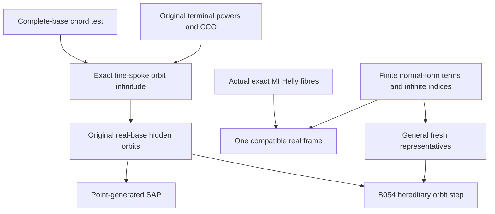

# Typed exact-coloured orbits, compatible MI fibres and fresh real frames

Generated from `module.json` by `tools/build_formalization_module.py`.

Source `490c3f36d85db5a0b3ced0598e6c431825254ec5`. **Human-expanded proof plan; no Lean code.**

Private B053: all SEVEN source11 results and FOUR equations; eight definitions, 62 human claims and seven tasks. Exact old one-point types give infinite unforced MI-coordinate orbits by high-chromatic old CCO diagrams. This proves point-generated SAP only after the real-base orbit calculation. Actual MI class incidence and simultaneous term-sensitive fibre avoidance give fresh real frames over arbitrary finite closed hidden sets; hereditary hidden orbits are reserved for B054. Literal standing terminal infinite FULL covers, the identity-term case, compatible same-sort frames versus general incompatible/different-sort frames, and original-group versus full-hidden-Aut distinctions remain explicit.

The human article remains unchanged. Additional proof details are in
[PROOF_NOTES.md](PROOF_NOTES.md); the cross-track policy is in
[the formalization guide](../README.md). Source hashes are checked before
the index is regenerated. Graph validation is not proof verification.

## Source premises

**A01: Actual complete binary typed homogeneous source.** M is the homogeneous limit in the standing finite complete binary terminal setting, with nonempty transitive named real sorts, finitely many actual typed orbitals, symmetric same-sort atoms and converse cross-sort atoms. G=Aut(M) acts on actual named quotient sorts by equivariant unary maps.

**A02: Original visible SAP.** The actual original finite age has SAP over EVERY complete finite real base, including the empty base. It gives pinned relational injectivisation and infinite off-base real orbits; no hidden SAP is assumed.

**A03: Original semantic HOM CCO.** Every finite typed partial old atomic graph whose specified simple cycles admit old homomorphisms has ONE whole old homomorphism. One-point root/base factors are actual binary diagrams. An optional higher-arity reading needs the separately stated support-normal interface and is not inferred here.

**A04: Standing terminal FULL infinite covers.** Every strict cover in the finite FULL original invariant-equivalence lattice on EACH real sort has INFINITE relative index, including Top covers. This is the literal ass:standing infinite-cover branch, stronger in its wording than merely excluding index two. Every strict interval then has infinite relative index by C31; the weaker no-index-two route would additionally require the full Hasse theorem.

**A05: Actual transition-enriched MI-only hidden signature.** The hidden universe contains original reals and ONLY actual proper NONIDENTITY meet-irreducible quotient sorts with all named projections, upward maps, quotient bijections and inverses, and actual semantic-cylinder binary relations. All vertices are point-generated in the full universe; finite induced hidden subobjects can have orphans. No nullary vertex generators. All terms act in this SAME actual interpretation; no chart is chosen.

## Imported theorem contracts

These are named provider obligations for the receiving Lean project,
not new axioms or claims of compiled imports.

| ID and source | Contract | Current provider status |
|---|---|---|
| I01: [`lem:typed-raw-strong-saturation`](../../sections/v27/07_typed_raw_strong_transition.tex#L25) | Nonzero RAW/STRONG saturation and strict old binary pinned-path support; for a diversity fork its STRONG profile equals the distinct-endpoint RAW relation. Logical identity is handled separately, never as a diversity edge. | HUMAN_EXPANDED_NOT_LEAN |
| I02: [`lem:typed-quotient-transport`](../../sections/typed_invariant_quotient_transport.tex#L15) | For actual nonempty typed R with RRop subset J, actual quotient bijection to J^R, canonical inverse and FULL upper-interval lattice isomorphism preserve MI and Top strictness. Generic invariant transport is not automatic terminal namedness. | HUMAN_EXPANDED_NOT_LEAN |
| I03: [`lem:no-real-algebraic-transition`](../../sections/v27/07_typed_raw_strong_transition.tex#L572) | Original visible SAP prevents a proper nonidentity MI quotient from becoming old real equality; transport remains a proper represented coordinate once terminal full/exact identification is discharged. | HUMAN_EXPANDED_NOT_LEAN |
| I04: [`lem:typed-prime-intersection`](../../sections/v27/07_typed_raw_strong_transition.tex#L520) | For terminal proper represented MI J, a nonempty finite meet of STRONG exact domains inside J forces one defining domain inside J. The source wrapper retains positive original word presentations and FULL terminal identification. | HUMAN_EXPANDED_NOT_LEAN |
| I05: [`lem:typed-terminal-pure-power`](../../sections/terminal_strong_powers.tex#L6) | Under actual original SAP and full no-index-two, any same-sort atom e has a uniform positive STRONG power threshold with e^n equal to its connectivity diversity palette for all large n; no CCO or hidden SAP in this provider. | HUMAN_EXPANDED_NOT_LEAN |
| I06: [`cor:high-girth-high-chromatic`](../../sections/sparse_labelled_graphs.tex#L68) | For every finite chromatic/girth bound there is a finite graph exceeding both. Only the graph existence export is imported. | HUMAN_EXPANDED_NOT_LEAN |
| I07: [`lem:typed-unary-closure-bound`](../../sections/v27/10_typed_unary_terms_return.tex#L66) | There are finitely many actual unary term FUNCTIONS from each hidden sort, uniformly bounded one-generated closures in genuine completed or unary-admissible diagrams; arbitrary partial unary cycles are excluded. | HUMAN_EXPANDED_NOT_LEAN |
| I08: [`lem:typed-coordinate-normal-form`](../../sections/v27/10_typed_unary_terms_return.tex#L149) | Each real-source term is real identity with kernel Id, or literal theta composed with F_K for a nonzero proper represented MI K and a named quotient bijection/identity; equality of term values is exactly K and stabilisers agree. | HUMAN_EXPANDED_NOT_LEAN |
| I09: [`lem:typed-point-generated-sap-criterion`](../../sections/finite_orbit_avoidance.tex#L33) | Same original group real-base infinite hidden orbits outside full closure imply strong amalgamation over full POINT-GENERATED common bases, via one finite avoidance move and complete original base alignment. Orphan hereditary SAP is not its conclusion. | HUMAN_EXPANDED_NOT_LEAN |
| I10: [`lem:rh-sap-invariant-monolith`](../../sections/real_hull/07_sap_mi_intersection_geometry.tex#L1) | Original SAP gives infinite real off-base orbits; two nonidentity invariant equivalences have infinite meet classes, hence all finite nonempty meets of nonidentity equivalences remain nonidentity with infinite classes. | HUMAN_EXPANDED_NOT_LEAN |
| I11: [`lem:typed-terminal-all-equivalences-exact`](../../sections/terminal_invariant_raw_exact.tex#L87) | Under actual terminal symmetric CCO context the FULL original invariant lattice is RAW exact and distributive. This is not assumed for an arbitrary group quotient lattice. | HUMAN_EXPANDED_NOT_LEAN |
| I12: [`thm:full-typed-exact-balls`](../../sections/exact_foundations/01_full_raw_exact_helly.tex#L27) | Pairwise-intersecting actual FULL RAW exact balls in one target real sort have a common point, including the empty family. Only the original ball-Helly export is used. | HUMAN_EXPANDED_NOT_LEAN |
| I13: [`lem:foundational-MI-coordinate-cofinal`](../../sections/exact_lattice_crt.tex#L68) | In a finite DISTRIBUTIVE lattice, meet E_i <= proper MI J implies some E_i<=J; original quotient-coordinate upward images are actual maps. Nonempty family required, empty Top case handled separately. | HUMAN_EXPANDED_NOT_LEAN |
| I14: [`lem:finite-action-avoidance`](../../sections/finite_orbit_avoidance.tex#L6) | For any group action and finite moving set all of whose point orbits are infinite, ONE group element avoids any prescribed finite forbidden set. Keep sort tags for different coordinates. | HUMAN_EXPANDED_NOT_LEAN |
| I15: [`cor:typed-forced-term-factorisation`](../../sections/v27/10_typed_unary_terms_return.tex#L216) | If nonzero represented J<=K_tau, the ACTUAL real-source term factors through F_J by a literal NAMED unary term, including RAW diagonal returns. Constancy alone would not prove membership in hidden unary closure. | HUMAN_EXPANDED_NOT_LEAN |
| I16: [`lem:foundational-quotient-fibre-avoidance`](../../sections/unary_fresh_frame_sap.tex#L65) | Transitive real action plus finitely many actual equivariant term functions, named forced factors and infinite relative indices for unforced terms gives one representative avoiding ALL finite forbidden outputs while preserving every forced output; sequential finite requests allowed. No SAP/CCO/homogeneity premise in this abstract provider. | HUMAN_EXPANDED_NOT_LEAN |
| I17: [`lem:typed-cylinder-realisation`](../../sections/v27/07_typed_raw_strong_transition.tex#L913) | Actual hidden quotient position pairs have representative-independent full semantic spectra; choosing different real representatives does not change retained actual hidden binary relations. | HUMAN_EXPANDED_NOT_LEAN |

**I01 internal proof support:** C01 in `transition_closure`. Use strict proved ancestor C01 ONLY for old binary atomic homomorphism injectivisation with designated complete endpoint pair frozen and aligned by old homogeneity; it is not a new export or a Set-Pasch/exactness assumption.

These are separately extracted proved support claims, not additional
numbered exports or consequences of the named theorem statement.

**I07 internal proof support:** C12 in `unary_terms_return`. Use strict proved ancestor unary_terms_return C12 for the explicitly proved finite set of actual unary term FUNCTIONS, not merely its finite image at a generator. This supports the finite common moving set in C36/C39/C42; infinitely many syntactic words may coincide. No extra source export or additional hypothesis is introduced.

These are separately extracted proved support claims, not additional
numbered exports or consequences of the named theorem statement.

## Definitions

| ID | Definition | Exact meaning | Source |
|---|---|---|---|
| D01 | Complete base and clone graph | D is a complete actual finite real diagram, X is a disjoint formal set, every X-D pair has a specified diversity atom; only H edges inside X are specified. | [source](../../sections/v27/11_typed_orbits_frames.tex#L2) |
| D02 | Exact-coloured one-point fibre | p(x/D) is a REALISED complete old atomic one-point type. Its new point is outside D when its chosen coordinate is outside cl(D). P_d is the STRONG diversity fork t_d*t_d^op. | [source](../../sections/v27/11_typed_orbits_frames.tex#L42) |
| D03 | Full point-generated unary closure | D^coord is the union of one-generated hidden closures of reals in D, under ALL named transitions/upward maps, including original reals via identity terms. Empty closure is empty. | [source](../../sections/v27/11_typed_orbits_frames.tex#L208) |
| D04 | Same-sort actual class incidence fibre | C_i are actual E_i-classes on ONE original sort and meet pairwise. H=meet_i E_i and X=intersection_i C_i. Empty list means H=Top,X=M_a. | [source](../../sections/v27/11_typed_orbits_frames.tex#L300) |
| D05 | Forced and unforced term kernels | A real-source tau has kernel K_tau=Id for identity, otherwise nonzero proper represented MI. Relative to a fibre cut H, forced means H<=K_tau; otherwise unforced. Forced values may lie in the forbidden set and are retained. | [source](../../sections/v27/11_typed_orbits_frames.tex#L408) |
| D06 | Compatible MI orphan frame | For same-sort pairwise-compatible MI quotient vertices b_i, A=cl({b_i}); the request is ONE real x with cl(x) intersect B=A. This is narrower than arbitrary incompatible/different-sort orphan bases. | [source](../../sections/v27/11_typed_orbits_frames.tex#L408) |
| D07 | General finite fresh representative request | A<=B are finite actual induced unary-closed hidden sets, F is any further finite hidden set. Choose one real preimage x_b for each proper coordinate b in A, sequentially preserving forced terms and avoiding every forbidden unforced value. | [source](../../sections/v27/11_typed_orbits_frames.tex#L488) |
| D08 | Original-group stabiliser | G=Aut(M) acts on actual hidden sorts. G_D fixes complete original real D, G_X stabilises a class fibre SETWISE, G_b fixes a quotient vertex. These are not replaced by an unproved equality with full Aut(hidden). | [source](../../sections/v27/11_typed_orbits_frames.tex#L208) |

## Proof claims and direct dependencies

Every row has a human proof expansion. Each still needs an actual Lean
statement and proof. All old spoke types are actual complete finite diagrams; their STRONG profiles omit real identity. No arbitrary orphan SAP, hidden homogeneity, or higher-arity completion is assumed from old real SAP alone.

| ID and claim | Scope | Direct providers | Proof note |
|---|---|---|---|
| C01: Chordless cycles with one base vertex are triangles | chords | D01 | N01 in [notes](PROOF_NOTES.md) |
| C02: Two or more base vertices force a short chordless cycle | chords | D01, C01 | N01 in [notes](PROOF_NOTES.md) |
| C03: Glue homomorphic cycle IMAGES over their diversity chord | chords | A01, A02, D01 | N01 in [notes](PROOF_NOTES.md) |
| C04: Chord splitting induction proves the cycle test | chords | C01, C02, C03 | N01 in [notes](PROOF_NOTES.md) |
| C05: Unforced quotient class makes the old root genuinely new | exact_orbits | A05, D02, D03 | N02 in [notes](PROOF_NOTES.md) |
| C06: A guarded fork inside J implies RAW quotient-functionality | exact_orbits | A01, A02, I01, C05 | N02 in [notes](PROOF_NOTES.md) |
| C07: The actual spoke would name the supposedly unforced coordinate | exact_orbits | A04, A05, I02, I03, I11, C06 | N02 in [notes](PROOF_NOTES.md) |
| C08: Old SAP gives a nonempty common diversity fork intersection | exact_orbits | A01, A02, C05, D02 | N02 in [notes](PROOF_NOTES.md) |
| C09: Exact MI-primality produces one external fine atom | exact_orbits | A04, I04, C07, C08 | N02 in [notes](PROOF_NOTES.md) |
| C10: Choose the sparse high-chromatic clone diagram | exact_orbits | A01, A02, A04, I05, I06, C09 | N02 in [notes](PROOF_NOTES.md) |
| C11: All base triangles are actual old triangles | exact_orbits | C08, C09, C10 | N02 in [notes](PROOF_NOTES.md) |
| C12: Long clone-only cycles use the positive power threshold | exact_orbits | I01, I05, C10 | N02 in [notes](PROOF_NOTES.md) |
| C13: Every displayed old cycle is completable | exact_orbits | C04, C11, C12 | N02 in [notes](PROOF_NOTES.md) |
| C14: Invoke old CCO once and align the WHOLE real base | exact_orbits | A01, A03, C13 | N02 in [notes](PROOF_NOTES.md) |
| C15: Class labels properly colour H without global injectivity | exact_orbits | C09, C10, C14 | N02 in [notes](PROOF_NOTES.md) |
| C16: Exact-coloured orbit infinitude export | exact_orbits | C15 | N02 in [notes](PROOF_NOTES.md) |
| C17: Term values on the real base are fixed by its original stabiliser | real_base | A01, A05, D03, D08 | N03 in [notes](PROOF_NOTES.md) |
| C18: Point generation and normal form reduce every hidden vertex | real_base | A05, I08 | N03 in [notes](PROOF_NOTES.md) |
| C19: Real off-base values have infinite old orbits | real_base | A01, A02, I10, C18 | N03 in [notes](PROOF_NOTES.md) |
| C20: Coordinate off-base values inherit infinitely many distinct images | real_base | A01, I08, C16, C18 | N03 in [notes](PROOF_NOTES.md) |
| C21: Exact original real-base algebraic closure export | real_base | C17, C19, C20 | N03 in [notes](PROOF_NOTES.md) |
| C22: The real-base closure cardinality is linear | real_base | A05, I07, C21 | N03 in [notes](PROOF_NOTES.md) |
| C23: Discharge all point-generated criterion inputs | point_generated | A01, A05, I07, C21 | N04 in [notes](PROOF_NOTES.md) |
| C24: Point-generated hidden SAP follows without orphan SAP | point_generated | I09, C23 | N04 in [notes](PROOF_NOTES.md) |
| C25: Point-generated SAP source export | point_generated | C24 | N04 in [notes](PROOF_NOTES.md) |
| C26: Full terminal equivalences are distributive RAW exact | mi_fibres | A01, A03, A04, I11 | N05 in [notes](PROOF_NOTES.md) |
| C27: Pairwise class incidence has a genuine common real witness | mi_fibres | I12, C26, D04 | N05 in [notes](PROOF_NOTES.md) |
| C28: The common fibre is infinite including the empty family | mi_fibres | A02, I10, C27 | N05 in [notes](PROOF_NOTES.md) |
| C29: Meet-primality determines forced coordinates from ONE class | mi_fibres | I13, C26, C27 | N05 in [notes](PROOF_NOTES.md) |
| C30: Every unforced MI cuts a proper subfibre | mi_fibres | C27, D04 | N05 in [notes](PROOF_NOTES.md) |
| C31: Standing infinite FULL covers imply all strict indices infinite | mi_fibres | A01, A04 | N05 in [notes](PROOF_NOTES.md) |
| C32: The setwise fibre stabiliser is transitive on X | mi_fibres | A01, C27, D08 | N05 in [notes](PROOF_NOTES.md) |
| C33: One tagged avoidance move handles ALL unforced MI coordinates | mi_fibres | I14, C30, C31, C32 | N05 in [notes](PROOF_NOTES.md) |
| C34: Actual MI-fibre dichotomy source export | mi_fibres | C28, C29, C30, C31, C33 | N05 in [notes](PROOF_NOTES.md) |
| C35: A compatible same-sort orphan family is generated by any point in X | compatible_frame | A05, C27, C28, D06 | N06 in [notes](PROOF_NOTES.md) |
| C36: Every forced nonidentity term is already a named value in A | compatible_frame | I07, I08, I15, C28, C29, C35 | N06 in [notes](PROOF_NOTES.md) |
| C37: Unforced hidden term values have infinite G_X-orbits | compatible_frame | I08, C30, C31, C32 | N06 in [notes](PROOF_NOTES.md) |
| C38: Handle real identity SEPARATELY from the proper-MI dichotomy | compatible_frame | C28, C32 | N06 in [notes](PROOF_NOTES.md) |
| C39: ONE action chooses the entire compatible fresh frame | compatible_frame | I07, I14, C36, C37, C38 | N06 in [notes](PROOF_NOTES.md) |
| C40: The compatible frame has the exact closure intersection | compatible_frame | C35, C36, C39 | N06 in [notes](PROOF_NOTES.md) |
| C41: Compatible one-real-frame source export | compatible_frame | C40 | N06 in [notes](PROOF_NOTES.md) |
| C42: Start each general request in its ACTUAL transitive real fibre | fresh_frames | A01, A05, I07, I08, D07 | N07 in [notes](PROOF_NOTES.md) |
| C43: Forced outputs are literal named terms of the SAME b | fresh_frames | A05, I15, C42 | N07 in [notes](PROOF_NOTES.md) |
| C44: Every unforced fibre term has an infinite original orbit | fresh_frames | I08, C31, C42 | N07 in [notes](PROOF_NOTES.md) |
| C45: The common abstract avoidance provider is fully discharged | fresh_frames | I16, C42, C43, C44 | N07 in [notes](PROOF_NOTES.md) |
| C46: Sequential requests remain finite and preserve forced coincidences | fresh_frames | I07, C45, D07 | N07 in [notes](PROOF_NOTES.md) |
| C47: Identity outputs force all real representatives distinct and fresh | fresh_frames | A05, C45, C46 | N07 in [notes](PROOF_NOTES.md) |
| C48: Changing representatives preserves the retained hidden structure | fresh_frames | I17, C46 | N07 in [notes](PROOF_NOTES.md) |
| C49: The union of real frames covers every vertex of A | fresh_frames | A05, C46, D03 | N07 in [notes](PROOF_NOTES.md) |
| C50: The general frame has the exact requested B intersection | fresh_frames | C43, C46, C49 | N07 in [notes](PROOF_NOTES.md) |
| C51: Typed fresh representatives source export | fresh_frames | C47, C48, C50 | N07 in [notes](PROOF_NOTES.md) |
| C52: Abstract finite freshness has a weaker mathematical premise | boundary | C45 | N08 in [notes](PROOF_NOTES.md) |
| C53: Identity-term repair is a proof expansion, not an added MI axiom | boundary | C38, C39 | N08 in [notes](PROOF_NOTES.md) |
| C54: Incomplete spokes do not define an exact old one-point orbit | boundary | C14, C16, C34 | N08 in [notes](PROOF_NOTES.md) |
| C55: Do not assume arbitrary orphan hidden homogeneity or SAP | boundary | C21, C25, C51 | N08 in [notes](PROOF_NOTES.md) |
| C56: Finite relative index can obstruct a newly visible term | boundary |  | N08 in [notes](PROOF_NOTES.md) |
| C57: A non-MI meet quotient can create a cross-coordinate forced value | boundary |  | N08 in [notes](PROOF_NOTES.md) |
| C58: Chords require gluing over their actual pair image | boundary | C03 | N08 in [notes](PROOF_NOTES.md) |
| C59: Finite diagnostics test local invariants, not existence theorems | boundary | C16, C41, C51 | N08 in [notes](PROOF_NOTES.md) |
| C60: All orbit groups remain named throughout the proof | boundary | D08, C21, C32, C42 | N08 in [notes](PROOF_NOTES.md) |
| C61: Empty bases and identity cases have literal witnesses | boundary | C08, C22, C38, C41, C50 | N08 in [notes](PROOF_NOTES.md) |
| C62: Inherited qualifications and receiving obligations remain | boundary | C16, C25, C34, C41, C51 | N08 in [notes](PROOF_NOTES.md) |

The precise quantified contracts are in `module.json`. Provider-before-consumer
order (including definitions and source premises):

`A01 → A02 → A03 → A04 → A05 → C56 → C57 → D01 → D02 → D03 → D04 → D05 → D06 → D07 → D08 → I01 → I02 → I03 → I04 → I05 → I06 → I07 → I08 → I09 → I10 → I11 → I12 → I13 → I14 → I15 → I16 → I17 → C01 → C03 → C05 → C17 → C18 → C26 → C31 → C42 → C02 → C06 → C08 → C19 → C27 → C43 → C44 → C58 → C04 → C07 → C28 → C29 → C30 → C32 → C45 → C09 → C33 → C35 → C37 → C38 → C46 → C52 → C10 → C34 → C36 → C47 → C48 → C49 → C11 → C12 → C39 → C50 → C13 → C40 → C51 → C53 → C14 → C41 → C15 → C16 → C20 → C54 → C59 → C21 → C22 → C23 → C60 → C24 → C61 → C25 → C55 → C62`

This order is one valid linearization; it does not require unrelated
branches to be proved sequentially. The full DAG is the `depends_on`
relation in `module.json`.

## Main proof branches

This is a coarse view of the claim DAG. Edges go from provider to consumer.

All seven source11 results and four equations are locally prepared; hereditary hidden-orbit result belongs to B054.
The real-identity term is handled separately from the proper-MI dichotomy but included in the SAME finite avoidance action.
Literal standing terminal infinite FULL covers imply the infinite-index fibre premise; merely no-index-two needs its separate Hasse bridge.
The last freshness step is abstractly CCO-free once actual finite functions, named factors and indices are established.

## Article exports

| Existing source result | Sidecar proof claims |
|---|---|
| [`lem:typed-complete-base-chords`](../../sections/v27/11_typed_orbits_frames.tex#L1) | C04 |
| [`lem:typed-exact-orbit-infinitude`](../../sections/v27/11_typed_orbits_frames.tex#L41) | C16 |
| [`cor:typed-no-real-base-hidden-algebraicity`](../../sections/v27/11_typed_orbits_frames.tex#L207) | C21, C22 |
| [`prop:typed-coordinate-sap`](../../sections/v27/11_typed_orbits_frames.tex#L265) | C25 |
| [`lem:typed-mi-fibre-infinite-dichotomy`](../../sections/v27/11_typed_orbits_frames.tex#L299) | C34 |
| [`cor:typed-compatible-mi-single-real-frame`](../../sections/v27/11_typed_orbits_frames.tex#L407) | C41 |
| [`lem:typed-fresh-representatives`](../../sections/v27/11_typed_orbits_frames.tex#L487) | C51 |

Auxiliary source equations (not additional numbered results):

- [`eq:typed-unforced-spoke`](../../sections/v27/11_typed_orbits_frames.tex#L64): C07
- [`eq:typed-no-real-base-hidden-algebraicity`](../../sections/v27/11_typed_orbits_frames.tex#L215): C21
- [`eq:typed-coordinate-orbit-stabilizer`](../../sections/v27/11_typed_orbits_frames.tex#L280): C25
- [`eq:typed-compatible-mi-single-real-frame`](../../sections/v27/11_typed_orbits_frames.tex#L425): C41

## Internal implementation milestones

These tasks are proof milestones inside larger project assignments;
see the [peer-project allocation](../coordination/BOARD.md).

These are implementation tasks, not additional mathematical assumptions.

| Task | Earlier tasks | Acceptance |
|---|---|---|
| T01: Chord geometry and cycle-image gluing | — | Use actual complete old types and image gluing over chord endpoints; align ONE entire old base before orbit counting. Preserve STRONG/RAW distinction, full infinite covers, all identity-term outputs in the same avoidance move, literal named factorisation, point-generated versus hereditary bases, actual original group, and finite functions rather than syntax. Fresh-frame/MI-class incidence branches do not replace exact-coloured orbit infinitude. No hidden homogeneity or SAP imported into their own proof. |
| T02: Exact fine-spoke orbit infinitude | T01 | Use actual complete old types and image gluing over chord endpoints; align ONE entire old base before orbit counting. Preserve STRONG/RAW distinction, full infinite covers, all identity-term outputs in the same avoidance move, literal named factorisation, point-generated versus hereditary bases, actual original group, and finite functions rather than syntax. Fresh-frame/MI-class incidence branches do not replace exact-coloured orbit infinitude. No hidden homogeneity or SAP imported into their own proof. |
| T03: Real-base closure and point-generated SAP | T02 | Use actual complete old types and image gluing over chord endpoints; align ONE entire old base before orbit counting. Preserve STRONG/RAW distinction, full infinite covers, all identity-term outputs in the same avoidance move, literal named factorisation, point-generated versus hereditary bases, actual original group, and finite functions rather than syntax. Fresh-frame/MI-class incidence branches do not replace exact-coloured orbit infinitude. No hidden homogeneity or SAP imported into their own proof. |
| T04: Actual MI Helly fibres and simultaneous class avoidance | — | Use actual complete old types and image gluing over chord endpoints; align ONE entire old base before orbit counting. Preserve STRONG/RAW distinction, full infinite covers, all identity-term outputs in the same avoidance move, literal named factorisation, point-generated versus hereditary bases, actual original group, and finite functions rather than syntax. Fresh-frame/MI-class incidence branches do not replace exact-coloured orbit infinitude. No hidden homogeneity or SAP imported into their own proof. |
| T05: One compatible fresh real frame | T04 | Use actual complete old types and image gluing over chord endpoints; align ONE entire old base before orbit counting. Preserve STRONG/RAW distinction, full infinite covers, all identity-term outputs in the same avoidance move, literal named factorisation, point-generated versus hereditary bases, actual original group, and finite functions rather than syntax. Fresh-frame/MI-class incidence branches do not replace exact-coloured orbit infinitude. No hidden homogeneity or SAP imported into their own proof. |
| T06: Arbitrary actual orphan representatives | T04 | Use actual complete old types and image gluing over chord endpoints; align ONE entire old base before orbit counting. Preserve STRONG/RAW distinction, full infinite covers, all identity-term outputs in the same avoidance move, literal named factorisation, point-generated versus hereditary bases, actual original group, and finite functions rather than syntax. Fresh-frame/MI-class incidence branches do not replace exact-coloured orbit infinitude. No hidden homogeneity or SAP imported into their own proof. |
| T07: Boundary cases and inherited scope | T01, T02, T03, T04, T05, T06 | Use actual complete old types and image gluing over chord endpoints; align ONE entire old base before orbit counting. Preserve STRONG/RAW distinction, full infinite covers, all identity-term outputs in the same avoidance move, literal named factorisation, point-generated versus hereditary bases, actual original group, and finite functions rather than syntax. Fresh-frame/MI-class incidence branches do not replace exact-coloured orbit infinitude. No hidden homogeneity or SAP imported into their own proof. |

## Finite controls

- **K01.** Exhaustive bounded complete-base chord classification and recursive image-compatible cycle splitting; explicit class-colouring counts without requiring global injectivity.
- **K02.** Actual finite independent-coordinate/clones windows test all term kernels, one common compatible-frame avoidance, general incompatible mixed-sort orphan freshness, forced overlaps and identity-term freshness. Term-visible index-two and non-MI cross-cell obstruction controls remain negative tests, not terminal sources.

Run `python tools/check_typed_orbit_frame_controls.py` from the manuscript directory.
The controls do not prove CCO or the general theorems.

## Return to the human articles

No required mathematical repair was found in this scoped pass. These
optional wording clarifications remain queued for a human article pass:

- **F01** ([source](../../sections/v27/11_typed_orbits_frames.tex#L463)): The compatible-frame proof invokes a proper-MI dichotomy for every unforced term, although the real identity has kernel Id and is outside that stated dichotomy. Treat identity separately using infinite X and transitivity of G_X; add it to the same finite moving set before one avoidance application. Make explicit the standing infinite-cover premise when asserting infinite strict relative indices.
- **F02** ([source](../../sections/v27/11_typed_orbits_frames.tex#L35)): Cycle realizations may be noninjective; gluing is performed on their induced finite image structures over the complete diversity chord image. Spell out image structures and pair alignment; collisions away from the chord remain allowed.

The machine ledger records caller effects and affected claims. The source
review used two independent model review passes and parent synthesis;
it is not independent human or formal certification.
