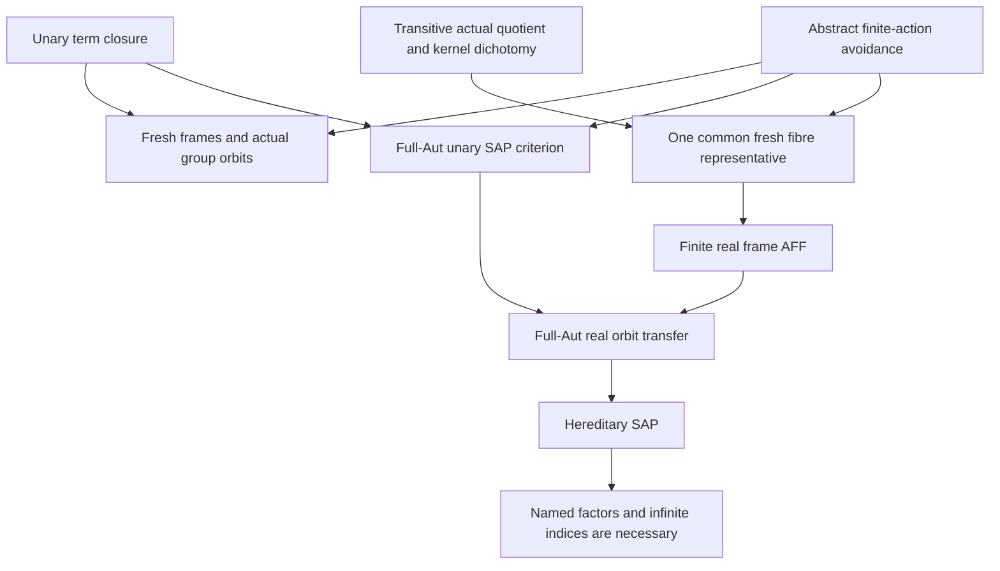

# Fresh real frames, actual quotient-fibre avoidance and hereditary unary SAP

Generated from `module.json` by `tools/build_formalization_module.py`.

Source `490c3f36d85db5a0b3ced0598e6c431825254ec5`. **Human-expanded proof plan; no Lean code.**

Private B039: FIVE Foundations I results and THREE auxiliary equations, including the previously unexpanded homogeneous unary SAP criterion as a SELECTED extra result. Expand generic fresh-frame/orbit equivalence, simultaneous avoidance in ONE actual quotient fibre, the relative-kernel sufficient criterion and its exact converse. Import ONLY the abstract finite-action avoidance proof from B010, not its CCO/owner geometry. The AFF construction itself uses neither homogeneous/countable H nor real-base orbit infinitude; those premises enter only the acl/dcl/SAP conclusion. No CCO, original SAP, lattice geometry, HN/HKN theorem or new external provider input.

The human article remains unchanged. Additional proof details are in
[PROOF_NOTES.md](PROOF_NOTES.md); the cross-track policy is in
[the formalization guide](../README.md). Source hashes are checked before
the index is regenerated. Graph validation is not proof verification.

## Source premises

**A01: Typed unary closure without nullary generators.** H is a many-sorted structure with arbitrary relations; every named function is UNARY and TOTAL on its specified source sort. There are NO nullary generators. The closure of every finite set under well-sorted unary terms is finite (for the fibre lemma finite singleton closures suffice). Include the identity term on every sort; closures are sets of actual vertices, and the empty closure is empty.

**A02: Actual automorphism subgroup.** G is an actual subgroup of Aut(H), preserving all named sorts, relations and unary functions. Every named unary term is G-equivariant. G need not equal the full automorphism group, be closed, countable or faithful.

**A03: Invariant generating union of real sorts.** For the generic frame equivalence, R is a G-invariant union of named real sorts and every vertex of H is a unary term value of some point of R. Every finite A therefore has a FINITE real generating cover. No transitivity or homogeneity is assumed in this branch.

**A04: Generic SAME-G real-base orbit condition.** For every finite D subset R and every u outside cl(D), the ACTUAL orbit G_D.u is infinite. This is the standing premise for fresh frames => closed-base orbit infinitude; the reverse direction needs only its stated closed-base orbit premise and does NOT use A04.

**A05: Independent homogeneous unary age setting.** For the unary SAP criterion H is COUNTABLE and HOMOGENEOUS for finite induced unary-CLOSED substructures. Age(H) is the isomorphism-closed class of all such finite substructures. No finite-language, oligomorphic, CCO, original SAP or real-sort generation assumption is needed by this criterion. Algebraicity means finite full-Aut stabiliser orbits, and definability means singleton such orbits.

**A06: One ACTUAL named quotient of a transitive real sort.** G is transitive on named real sort M. p_J:M->Q is a NAMED surjective equivariant unary projection with actual kernel equivalence J STRICTLY ABOVE Id_M. For each actual well-sorted unary term tau:M->H_s, K_tau is its actual kernel. The relative index [J:J meet K_tau] means the number of K_tau-classes meeting one J-class, equivalently |tau(p_J^-1(b))|; transitivity makes it independent of b. It is NOT a formal subgroup index or a division of cardinalities.

**A07: Literal named factorisation for FORCED terms.** For EVERY actual real-source unary term tau with J<=K_tau, there exists an ACTUAL NAMED well-sorted unary term sigma:Q->H_s such that tau=sigma composed p_J on ALL M. A set map constant on fibres, even a definable one, does not replace this term premise.

**A08: Infinite relative index for UNFORCED terms.** For EVERY actual real-source unary term tau with J not<=K_tau, the actual fibre image cardinality [J:J meet K_tau] is infinite. The identity term is included, has kernel Id_M and is unforced because J>Id_M. No finite-only experiment establishes this hypothesis.

**A09: Retained homogeneous finite-language theorem scope.** For the FINAL theorem/corollary scope retain countable homogeneous oligomorphic H in a FINITE named language, with A01 total typed unary functions, no nullary generators and finite unary closures. This supplies the homogeneous criterion A05, but is NOT an active premise of the narrower AFF construction C28-C33.

**A10: Main theorem FULL-Aut real-base orbit condition.** For every finite original real D and every vertex u of H (real or nonreal) outside cl(D), Aut(H/D).u is infinite. This is about FULL Aut(H), not necessarily the smaller transitive subgroup G. It is used after AFF to conclude acl=dcl=cl and hereditary SAP, not to construct the fresh frame itself.

**A11: Finite original real-sort family and actual named representations.** G<=Aut(H) is transitive on each of FINITELY MANY named original real sorts M_a. Every NONREAL hidden vertex b has a representation b=p_J(x) for a NAMED surjective equivariant actual quotient p_J:M_a->Q_(a,J), J>Id_a. For the sufficient criterion apply A06-A08 to every such projection and actual term. Real vertices need no nonidentity quotient representation. This supplies real generation and the FINITE real-sort family; no homogeneity, countability, oligomorphy, CCO or SAP is assumed here.

## Imported theorem contracts

These are named provider obligations for the receiving Lean project,
not new axioms or claims of compiled imports.

| ID and source | Contract | Current provider status |
|---|---|---|
| I01: [`lem:finite-action-avoidance`](../../sections/finite_orbit_avoidance.tex#L6) | For ANY group action, finite moving set S with every orbit infinite, and finite forbidden Z, there is ONE g sending ALL S outside Z. Reuse ONLY the elementary coset-cover proof; empty S/Z and nonfaithful actions are allowed. No topology, CCO, real closure, owner geometry or EPPA premise is imported. | HUMAN_EXPANDED_NOT_LEAN |

**I01 internal proof support:** C01, C02 in `acl_owner_geometry`. C01 proves the abstract virtual-containment preorder and C02 proves the finite coset-cover lemma; they are strict proved ancestors of C03, which converts forbidden action incidences into transporter cosets and yields simultaneous avoidance. Extract their abstract group/action hypotheses only, never CCO/owner branches.

These are separately extracted proved support claims, not additional
numbered exports or consequences of the named theorem statement.

## Definitions

| ID | Definition | Exact meaning | Source |
|---|---|---|---|
| D01 | Actual unary closure | cl(T) is all well-sorted named unary term values of points of T, INCLUDING identity terms. With no nullary generators cl(empty)=empty; arbitrary finite unions of closed sets are closed. | [source](../../sections/unary_fresh_frame_sap.tex#L8) |
| D02 | Pointwise stabilisers and closure equivariance | G_T fixes EVERY point of T; Aut(H/T) uses the full automorphism group. Unary term equivariance gives g cl(T)=cl(gT) and equality of stabilisers for T and cl(T). | [source](../../sections/unary_fresh_frame_sap.tex#L8) |
| D03 | Orbit-theoretic acl and dcl | acl_G(T) consists of vertices with finite G_T-orbit, and dcl_G(T) those with singleton orbit. Unsubscripted acl_H/dcl_H use FULL Aut(H). The packages do not switch subgroup orbits to full-Aut orbits silently. | [source](../../sections/unary_fresh_frame_sap.tex#L8) |
| D04 | Fresh real frame separation | For every finite induced unary-closed A subset B there exists finite D subset R with A subset cl(D) and cl(D) intersect B=A. D may include real A points; no functorial or canonical frame is required. | [source](../../sections/unary_fresh_frame_sap.tex#L8) |
| D05 | Closed-base orbit infinitude | For every finite unary-closed A and every u outside A, G_A.u is infinite. This condition itself is the conditional antecedent in the reverse frame implication; no SAP of a subgroup action is presumed. | [source](../../sections/unary_fresh_frame_sap.tex#L8) |
| D06 | Hereditary unary-closed age and strong amalgams | Objects are ALL finite induced unary-closed substructures, including those not generated by real points. SAP asks for induced embeddings of any closed span with factor images intersecting exactly in the base. Arbitrary cross relations are those induced from a host; no FREE-amalgamation conclusion is asserted. | [source](../../sections/finite_orbit_avoidance.tex#L108) |
| D07 | Actual term kernel and quotient fibre | K_tau={(x,y):tau(x)=tau(y)}; J=ker(p_J). For b in Q let F_b={x:p_J(x)=b}. These are actual G-invariant equivalences and an actual nonempty fibre. | [source](../../sections/unary_fresh_frame_sap.tex#L66) |
| D08 | Relative fibre index | [J:J meet K_tau]=|tau(F_b)|, equivalently the number of (J meet K_tau)-classes in a J-class. Uniformity follows from actual transitive G. No commutation/exact lattice or formal numerical quotient is used. | [source](../../sections/unary_fresh_frame_sap.tex#L66) |
| D09 | Typed term functions and evaluation at one real point | Consider distinct actual functions tau:M->H_s induced by all named well-sorted terms, retaining output sorts. In a many-sorted disjoint carrier equality of their value at x0 forces same output sort; transitivity/equivariance determine their entire function. | [source](../../sections/unary_fresh_frame_sap.tex#L66) |
| D10 | Forced and unforced terms | A term is FORCED when J<=K_tau and UNFORCED otherwise. A07 supplies a named factor sigma and forced value sigma(b) in cl({b}); A08 supplies infinite G_b-orbits of unforced values. | [source](../../sections/unary_fresh_frame_sap.tex#L66) |
| D11 | Finite sequential representative request | For a finite list of represented quotient vertices, choose real representatives one at a time; the next finite forbidden set may contain an extra finite hidden set, previous representatives and their previous unforced term values. Forced coincidences are retained rather than forbidden. | [source](../../sections/unary_fresh_frame_sap.tex#L66) |
| D12 | Relative-kernel condition RK | Over EVERY named actual quotient and EVERY actual real-source term, require named factorisation in the forced case and infinite actual fibre index in the unforced case, together with full-Aut real acl=cl. This is a precise signature-dependent condition, not quantification over all conceivable equivariant maps. | [source](../../sections/unary_fresh_frame_sap.tex#L185) |

## Proof claims and direct dependencies

Every row has a human proof expansion. Each still needs an actual Lean
statement and proof. Distinguish the actual subgroup G from full Aut(H), actual fibre image cardinalities from abstract subgroup indices, and a NAMED unary factor term from a mere set-theoretic factor. Conditional implication claims explicitly discharge their temporary orbit/SAP premises when assembled.

| ID and claim | Scope | Direct providers | Proof note |
|---|---|---|---|
| C01: Unary closures are singleton unions, including the empty case | unary_closure | A01, D01 | N01 in [notes](PROOF_NOTES.md) |
| C02: Automorphisms commute with closure and stabilisers coincide | unary_closure | A01, A02, D02, C01 | N01 in [notes](PROOF_NOTES.md) |
| C03: Term closure is pointwise definable before any orbit hypothesis | unary_closure | A01, D03, C01 | N01 in [notes](PROOF_NOTES.md) |
| C04: Fresh frame separation implies closed-base infinite orbits | frame_orbits | D04, D05, A04, C01, C02 | N02 in [notes](PROOF_NOTES.md) |
| C05: Closed-base infinite orbits imply fresh frames by one common move | frame_orbits | A01, A02, A03, D04, D05, C01, C02, I01 | N02 in [notes](PROOF_NOTES.md) |
| C06: Generic fresh-frame equivalence and all finite hidden bases | frame_orbits | C02, C03, C04, C05 | N02 in [notes](PROOF_NOTES.md) |
| C07: Full-Aut SAP does not imply an arbitrary subgroup orbit condition | boundary | A02, D03, D05 | N09 in [notes](PROOF_NOTES.md) |
| C08: The age and induced union use unary closed substructures | hereditary_SAP | A01, A05, D06, C01 | N03 in [notes](PROOF_NOTES.md) |
| C09: Conditional SAP builds arbitrarily many disjoint off-base copies | hereditary_SAP | A01, A05, D06, C01 | N03 in [notes](PROOF_NOTES.md) |
| C10: Homogeneity puts each copied point in the actual base orbit | hereditary_SAP | A05, C09 | N03 in [notes](PROOF_NOTES.md) |
| C11: SAP implies infinite closed-base orbits | hereditary_SAP | C09, C10 | N03 in [notes](PROOF_NOTES.md) |
| C12: Put an arbitrary closed span inside H over its exact common base | hereditary_SAP | A05, D06 | N03 in [notes](PROOF_NOTES.md) |
| C13: Infinite closed-base orbits separate the two whole factors | hereditary_SAP | C12, I01 | N03 in [notes](PROOF_NOTES.md) |
| C14: Their induced unary-closed union is a strong age amalgam | hereditary_SAP | C08, C13 | N03 in [notes](PROOF_NOTES.md) |
| C15: Infinite closed-base orbits imply hereditary SAP | hereditary_SAP | C12, C13, C14 | N03 in [notes](PROOF_NOTES.md) |
| C16: Homogeneous unary SAP criterion with acl and dcl | hereditary_SAP | C02, C03, C11, C15 | N03 in [notes](PROOF_NOTES.md) |
| C17: Fresh-frame remark follows for the FULL automorphism group | hereditary_SAP | C06, C16 | N03 in [notes](PROOF_NOTES.md) |
| C18: Only finitely many distinct real-source term functions | fibre_avoidance | A01, A02, A06, D09, C02 | N04 in [notes](PROOF_NOTES.md) |
| C19: The quotient-point stabiliser is transitive on its actual fibre | fibre_avoidance | A02, A06, D07 | N04 in [notes](PROOF_NOTES.md) |
| C20: Term-value orbit equals its actual fibre image | fibre_avoidance | A02, D07, D08, C19 | N04 in [notes](PROOF_NOTES.md) |
| C21: Finitely many unforced values each have infinite stabiliser orbit | fibre_avoidance | A08, D10, C18, C20 | N04 in [notes](PROOF_NOTES.md) |
| C22: One fibre-stabilising automorphism avoids every unforced value | fibre_avoidance | C21, C19, I01 | N05 in [notes](PROOF_NOTES.md) |
| C23: Forced term values are literally named closure values of b | fibre_avoidance | A07, D10, C01 | N05 in [notes](PROOF_NOTES.md) |
| C24: Exact closure intersection equality, not only containment | fibre_avoidance | A06, C01, C22, C23 | N05 in [notes](PROOF_NOTES.md) |
| C25: The identity term guarantees the representative itself avoids Z | fibre_avoidance | A06, A08, C22 | N05 in [notes](PROOF_NOTES.md) |
| C26: Successive choices keep requests finite and allow forced coincidences | fibre_avoidance | C01, C22, C23, C24, C25, D11 | N05 in [notes](PROOF_NOTES.md) |
| C27: Actual quotient-fibre avoidance source export | fibre_avoidance | C22, C23, C24, C25, C26 | N05 in [notes](PROOF_NOTES.md) |
| C28: Start the main fresh frame with the actual real points of A | AFF_construction | A01, A11, C01 | N06 in [notes](PROOF_NOTES.md) |
| C29: Choose actual named quotient representations for every nonreal A point | AFF_construction | A11, C01 | N06 in [notes](PROOF_NOTES.md) |
| C30: Choose each representative fresh relative to B and all prior requests | AFF_construction | C27, C29 | N06 in [notes](PROOF_NOTES.md) |
| C31: The real union generates every point of A | AFF_construction | C28, C29, C30 | N06 in [notes](PROOF_NOTES.md) |
| C32: Singleton union proves AFF with exact empty-base behaviour | AFF_construction | C01, C28, C30, C31 | N06 in [notes](PROOF_NOTES.md) |
| C33: AFF construction is independent of homogeneous orbit assumptions | AFF_construction | C32 | N06 in [notes](PROOF_NOTES.md) |
| C34: AFF transfers FULL-Aut real-base infinitude to arbitrary closed bases | frame_orbits | A10, C01, C02, C32 | N07 in [notes](PROOF_NOTES.md) |
| C35: Relative-kernel sufficient criterion gives hidden acl=dcl=cl and SAP | hereditary_SAP | A09, C03, C16, C32, C34 | N07 in [notes](PROOF_NOTES.md) |
| C36: Uniform singleton bound is derived without an arbitrary-base bound | AFF_construction | A11, C01, C02 | N06 in [notes](PROOF_NOTES.md) |
| C37: For the converse assume SAP, not the kernel dichotomy | kernel_converse | A09, C16, A11 | N08 in [notes](PROOF_NOTES.md) |
| C38: A forced fibre value is fixed by FULL Aut over its quotient point | kernel_converse | A01, A11, D07 | N08 in [notes](PROOF_NOTES.md) |
| C39: SAP forces a named unary term realising that fixed value | kernel_converse | C01, C37, C38 | N08 in [notes](PROOF_NOTES.md) |
| C40: One equality extends to the global literal factor by transitive G | kernel_converse | A02, A11, C02 | N08 in [notes](PROOF_NOTES.md) |
| C41: A nonforced actual kernel has at least two values on every fibre | kernel_converse | A11, D08, C20 | N08 in [notes](PROOF_NOTES.md) |
| C42: Finite fibre image is full-Aut invariant and hence algebraic over b | kernel_converse | A01, A11, C41 | N08 in [notes](PROOF_NOTES.md) |
| C43: G_b transitivity shows that value lies outside named closure | kernel_converse | C01, C19, C20, C41 | N08 in [notes](PROOF_NOTES.md) |
| C44: SAP rules out every finite proper relative index | kernel_converse | C37, C40, C42, C43, C39 | N08 in [notes](PROOF_NOTES.md) |
| C45: The reverse condition instantiates the sufficient theorem exactly | kernel_converse | D12, C03, C35 | N08 in [notes](PROOF_NOTES.md) |
| C46: Exact relative-kernel characterisation source export | kernel_converse | C37, C40, C44, C45 | N08 in [notes](PROOF_NOTES.md) |
| C47: Missing named forced factor gives a definable off-closure value | boundary | A11, C01, C38, C40 | N09 in [notes](PROOF_NOTES.md) |
| C48: Finite proper relative index gives an algebraic off-closure value | boundary | C41, C42, C43 | N09 in [notes](PROOF_NOTES.md) |
| C49: Set-theoretic factorisation alone is insufficient and finite controls cannot prove infinity | boundary | D07, D08, C47, C48 | N09 in [notes](PROOF_NOTES.md) |
| C50: Unary and no-nullary restrictions protect the exact construction | boundary | C01, C14, C32 | N09 in [notes](PROOF_NOTES.md) |

The precise quantified contracts are in `module.json`. Provider-before-consumer
order (including definitions and source premises):

`A01 → A02 → A03 → A04 → A05 → A06 → A07 → A08 → A09 → A10 → A11 → I01 → D01 → D02 → D03 → D04 → D05 → D06 → D07 → D09 → D12 → C01 → C07 → C12 → C19 → C38 → D08 → D11 → C02 → C03 → C08 → C09 → C13 → C20 → C28 → C29 → D10 → C04 → C05 → C10 → C14 → C18 → C23 → C36 → C40 → C41 → C06 → C11 → C15 → C21 → C42 → C43 → C47 → C16 → C22 → C48 → C17 → C24 → C25 → C37 → C49 → C26 → C39 → C27 → C44 → C30 → C31 → C32 → C33 → C34 → C50 → C35 → C45 → C46`

This order is one valid linearization; it does not require unrelated
branches to be proved sequentially. The full DAG is the `depends_on`
relation in `module.json`.

## Main proof branches

This is a coarse view of the claim DAG. Edges go from provider to consumer.

The generic frame equivalence is for the ACTUAL subgroup G; the final hereditary SAP criterion uses FULL Aut(H).
AFF itself is a finite term/fibre construction. Full-Aut real-base orbit infinitude enters afterwards.
All unforced term functions are avoided by ONE group element; term syntax need not be finite.
The converse derives the named factor and infinite relative index rather than assuming either clause.
The selected upstream SAP lemma is expanded internally; other results in finite_orbit_avoidance.tex are not silently counted as new.
Five existing external HN/HKN receiving bindings and the provider-cache plan remain unchanged.

## Article exports

| Existing source result | Sidecar proof claims |
|---|---|
| [`lem:foundational-real-frame-orbits`](../../sections/unary_fresh_frame_sap.tex#L7) | C04, C05, C06 |
| [`lem:unary-homogeneous-sap-criterion`](../../sections/finite_orbit_avoidance.tex#L107) | C11, C15, C16 |
| [`lem:foundational-quotient-fibre-avoidance`](../../sections/unary_fresh_frame_sap.tex#L65) | C22, C23, C24, C25, C26, C27 |
| [`thm:typed-abstract-fresh-frame-sap`](../../sections/unary_fresh_frame_sap.tex#L120) | C32, C35, C36 |
| [`cor:typed-abstract-relative-kernel-sap-iff`](../../sections/unary_fresh_frame_sap.tex#L184) | C37, C40, C44, C45, C46 |

Auxiliary source equations (not additional numbered results):

- [`eq:unary-homogeneous-sap-criterion`](../../sections/finite_orbit_avoidance.tex#L120): C16
- [`eq:typed-abstract-fresh-frame`](../../sections/unary_fresh_frame_sap.tex#L150): C32
- [`eq:typed-abstract-kernel-iff`](../../sections/unary_fresh_frame_sap.tex#L205): C40, C44, C46

Full result coverage is asserted only for `source_result_files`.
Selected additional results: lem:unary-homogeneous-sap-criterion.
Other results in their provider source files are not claimed covered.

## Internal implementation milestones

These tasks are proof milestones inside larger project assignments;
see the [peer-project allocation](../coordination/BOARD.md).

These are implementation tasks, not additional mathematical assumptions.

| Task | Earlier tasks | Acceptance |
|---|---|---|
| T01: Unary closure and generic real-frame equivalence | — | Implement actual typed unary closure and terms, ONE simultaneous stabiliser move, exact induced age embeddings and literal named factors. Keep subgroup G and full Aut(H) distinct. Construct AFF before real-base orbit transfer. In the converse assume SAP only, then derive BOTH kernel clauses from local full-Aut algebraicity. Finite controls are diagnostics and cannot establish infinity. No CCO or external HN/HKN premise may enter. |
| T02: Expand the homogeneous hereditary unary SAP criterion | T01 | Implement actual typed unary closure and terms, ONE simultaneous stabiliser move, exact induced age embeddings and literal named factors. Keep subgroup G and full Aut(H) distinct. Construct AFF before real-base orbit transfer. In the converse assume SAP only, then derive BOTH kernel clauses from local full-Aut algebraicity. Finite controls are diagnostics and cannot establish infinity. No CCO or external HN/HKN premise may enter. |
| T03: Actual quotient fibre and simultaneous term avoidance | T01 | Implement actual typed unary closure and terms, ONE simultaneous stabiliser move, exact induced age embeddings and literal named factors. Keep subgroup G and full Aut(H) distinct. Construct AFF before real-base orbit transfer. In the converse assume SAP only, then derive BOTH kernel clauses from local full-Aut algebraicity. Finite controls are diagnostics and cannot establish infinity. No CCO or external HN/HKN premise may enter. |
| T04: Construct AFF and derive full-Aut hidden SAP | T01, T02, T03 | Implement actual typed unary closure and terms, ONE simultaneous stabiliser move, exact induced age embeddings and literal named factors. Keep subgroup G and full Aut(H) distinct. Construct AFF before real-base orbit transfer. In the converse assume SAP only, then derive BOTH kernel clauses from local full-Aut algebraicity. Finite controls are diagnostics and cannot establish infinity. No CCO or external HN/HKN premise may enter. |
| T05: Prove named-factor and index necessity from SAP | T01, T02, T03 | Implement actual typed unary closure and terms, ONE simultaneous stabiliser move, exact induced age embeddings and literal named factors. Keep subgroup G and full Aut(H) distinct. Construct AFF before real-base orbit transfer. In the converse assume SAP only, then derive BOTH kernel clauses from local full-Aut algebraicity. Finite controls are diagnostics and cannot establish infinity. No CCO or external HN/HKN premise may enter. |
| T06: Assemble the exact relative-kernel equivalence | T04, T05 | Implement actual typed unary closure and terms, ONE simultaneous stabiliser move, exact induced age embeddings and literal named factors. Keep subgroup G and full Aut(H) distinct. Construct AFF before real-base orbit transfer. In the converse assume SAP only, then derive BOTH kernel clauses from local full-Aut algebraicity. Finite controls are diagnostics and cannot establish infinity. No CCO or external HN/HKN premise may enter. |
| T07: Signature and local obstruction diagnostics | T01, T02, T03, T04, T05, T06 | Implement actual typed unary closure and terms, ONE simultaneous stabiliser move, exact induced age embeddings and literal named factors. Keep subgroup G and full Aut(H) distinct. Construct AFF before real-base orbit transfer. In the converse assume SAP only, then derive BOTH kernel clauses from local full-Aut algebraicity. Finite controls are diagnostics and cannot establish infinity. No CCO or external HN/HKN premise may enter. |

## Finite controls

- **K01.** Finite transitive action/fibre models check term evaluation injectivity, stabiliser transitivity, actual fibre index, simultaneous bounded avoidance and exact unary closure intersections; these do not prove infinite orbits.
- **K02.** Local missing-NAMED-factor and finite-proper-index mechanisms, subgroup/full-Aut distinction and unary/no-nullary proof boundaries are diagnosed with finite analogues.

Run `python tools/check_unary_fresh_frames_controls.py` from the manuscript directory.
The controls do not prove CCO or the general theorems.

## Return to the human articles

No required mathematical repair was found in this scoped pass. These
optional wording clarifications remain queued for a human article pass:

- **F01** ([source](../../sections/unary_fresh_frame_sap.tex#L99)): The single chosen representative avoids all unforced ACTUAL term functions at once; finiteness is from evaluation injectivity under transitivity, not a finite list of syntax. The relative index is an actual fibre image cardinality. Make explicit evaluation injectivity, G_b-transitivity on the actual fibre and the identity-term use of J>Id. Keep all forced named closure values, even if forbidden.
- **F02** ([source](../../sections/unary_fresh_frame_sap.tex#L176)): AFF is constructed before invoking full-Aut real-base orbit infinitude. In the converse FULL Aut fixes the forced value or preserves the finite fibre image, while the subgroup G supplies transitivity and a moving witness. Separate the finite AFF construction from the homogeneous orbit/SAP corollary, and label precisely which group is used in each necessity step. Emphasize named term factorisation rather than a definable/set map.

The machine ledger records caller effects and affected claims. The source
review used two independent model review passes and parent synthesis;
it is not independent human or formal certification.
