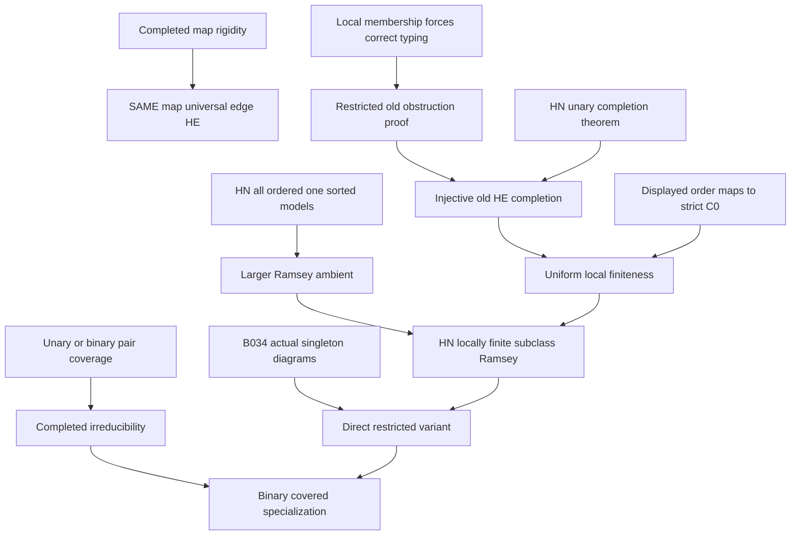

# Unary irreducibility, same-map universal edges and HN Ramsey transfer

Generated from `module.json` by `tools/build_formalization_module.py`.

Source `490c3f36d85db5a0b3ced0598e6c431825254ec5`. **Human-expanded proof plan; no Lean code.**

Private B037: FIVE Foundations III results, no equations. Prove unary/binary pair coverage gives irreducibility and completed-map rigidity transports the SAME old homomorphism-embedding across a universal irreflexive edge. Prove the restricted-obstruction unary HN transfer with exact uniform n=max(1,N), then its one-generated-admissible and binary-covered variants. Use an explicit one-sorted encoding and LARGER all-model ambient: the local irreducible-membership hypothesis itself forces correct sorts, unary domains/values and relation tuple typing. Three versioned HN2019 inputs remain published theorem/receiving Lean bridges pending; an exact existing Lean2.19 declaration is pinned read-only. Reuse ONLY B034 actual singleton diagrams/totality, not its size bounds. No arbitrary-malformed obstruction bound, CCO, EPPA or homogeneous geometry is supplied.

The human article remains unchanged. Additional proof details are in
[PROOF_NOTES.md](PROOF_NOTES.md); the cross-track policy is in
[the formalization guide](../README.md). Source hashes are checked before
the index is regenerated. Graph validation is not proof verification.

## Source premises

**A01: Finite typed partial unary convention.** Languages have finitely many named sorts, unary function symbols and relations of arbitrary finite arity. No constants or higher-arity functions occur. Empty sorts are allowed. Partial sources may have proper unary domains. Actual induced substructures reflect domains and retain all already-defined values and all relations; homomorphisms preserve positive relations and defined values. The one-sorted encoding uses unary sort predicates; raw ambient models may initially violate typing.

**A02: Pair-coverage lemma inputs.** For the first lemma A is finite induced unary-closed with TOTAL unary functions on intended input sorts. For every distinct x,y, x lies in closure{y}, or y lies in closure{x}, or a POSITIVE named binary tuple joins them in one orientation. Higher relational arities remain allowed; negative/missing tuples do not witness coverage.

**A03: Hereditary actual completed class.** K is an isomorphism-closed hereditary class of finite completed induced unary-closed typed structures. Functions are total on their prescribed input sorts and undefined off those sorts in the one-sorted encoding. Actual K membership means the existing entire induced diagram, not merely a completion. There is no automatic bound on generated closures.

**A04: Completed-map rigidity for the edge lemma.** ONLY for universal-edge transport, EVERY old L-homomorphism-embedding between completed K members is an induced embedding. This is weaker than asserting every homomorphism embeds; it follows if every completed member is irreducible. SAP alone does not imply it.

**A05: Universal-edge local source and given old map.** Expand K by universal irreflexive E_* to K*. C is a finite partial expanded source whose EVERY actual induced irreducible substructure belongs to K*. Its old reduct has a GIVEN old homomorphism-embedding h into H in K. The conclusion must use this SAME h, without replacing it by a different injective map.

**A06: Irreducible SAP class for the main transfer.** For the main/direct transfer, K as in A03 has SAP and EVERY completed member is old-L irreducible. The encoded one-sorted class has the same actual closed subobjects, free decompositions and strong-amalgamation spans as the typed class. Arbitrary added global linear orders are allowed; no universal-edge expansion is required.

**A07: Restricted all-irreducible-admissible obstruction bound.** There is an integer N such that each finite TYPED partial C, whose every old induced irreducible already belongs to K and which has NO K homomorphism-embedding completion, contains an actual induced unary-CLOSED noncompletable substructure with at most N points. The premise is restricted to this admissible domain, not arbitrary malformed unary inputs.

**A08: BOUND HN local-finiteness test data.** Fix any finite ordered ambient C0 and n=max(1,N). A candidate partial ordered C has (i) a homomorphism-embedding to C0, (ii) every actual expanded induced irreducible in K^<, and (iii) every actual induced substructure with at most n points has a K^< completion. These are BOUND inputs to the implication, not an assumed global completion or closure-size bound. In the larger ambient C is initially raw one-sorted.

**A09: Direct one-generated-admissible obstruction bound.** For the direct variant, keep hereditary completed SAP K and its irreducibility, but assume the same N-bound ONLY for noncompletable typed partial sources whose EVERY one-generated induced closure is already an actual completed K member. This supplies A07 after the B034 admissibility conversion. No uniform size bound on the closures or arbitrary malformed sources is assumed.

**A10: Binary-covered specialization.** For the last theorem replace the completed-class irreducibility input by positive named binary coverage of EVERY ordered distinct pair in each completed member. Retain the source arity-at-most-two condition, hereditary completed SAP setting and direct restricted obstruction premise. Binary coverage proves irreducibility, not that obstruction premise; no homogeneity/countability or auxiliary E_* is required.

## Published external theorem providers

These inputs are not new local proof claims or compiled CCO imports.
Existing Lean APIs still require the explicit representation bridge.

**E01: HN finite ordered models.** All finite linearly ordered one-sorted models of a fixed relation/partial-function language are Ramsey. Strict-order and ordered-copy/embedding conventions are adapted locally.

[Primary source, 1606.07979v4, 2.19](https://arxiv.org/html/1606.07979v4). Status: `PUBLISHED_THEOREM_LOCAL_BRIDGE_PENDING`.

Existing Lean: `janhubicka/partite-construction` at `918732dcff88fd1ab9be69f70e4f1d66385106e3`, module `PartiteConstruction.Ramsey.AllThosePartialFiniteModels`; declarations `StructuralRamsey.Structure.allThoseRamseyClasses_theorem_2_19_partialFunctions`.

The adapter to the current CCO encoding remains a receiving-project obligation.

**E02: HN unary injective completion.** For unary functions and hereditary irreducible SAP K, any finite source with a K completion has an injective homomorphism-embedding completion. No global inducedness is asserted.

[Primary source, 1606.07979v4, 2.6](https://arxiv.org/html/1606.07979v4). Status: `PUBLISHED_THEOREM_LOCAL_BRIDGE_PENDING`.

**E03: HN locally finite Ramsey subclass.** A hereditary locally finite SAP subclass of an irreducible finite Ramsey ambient is Ramsey. Local finiteness uses Definition2.8 actual substructures and ordinary completion.

[Primary source, 1606.07979v4, 2.11](https://arxiv.org/html/1606.07979v4). Status: `PUBLISHED_THEOREM_LOCAL_BRIDGE_PENDING`.

## Imported theorem contracts

These are named provider obligations for the receiving Lean project,
not new axioms or claims of compiled imports.

| ID and source | Contract | Current provider status |
|---|---|---|
| I01: [`lem:hn-irreducible-forces-unary-admissible`](../../sections/binary_unary_irreducible_local_cover.tex#L224) | For a TYPED partial unary source whose every induced irreducible belongs to actual completed K, each U_x is itself an ACTUAL completed K member and intended functions are already total. Reuse unary_support C20/C21. Its independent one-generated irreducibility proof C19 is recorded as internal support; no optional m-bound, term-identity export or hidden-specific admissibility interface is imported. | HUMAN_EXPANDED_NOT_LEAN |

**I01 internal proof support:** C19 in `unary_support`. C19 supplies the independent domain-reflecting one-generated closure mechanism before actual membership/totality. Receiving C37 uses the selected typed C20/C21 exactly; raw one-sorted typing C18-C22 is separately proved before any such typed application.

These are separately extracted proved support claims, not additional
numbered exports or consequences of the named theorem statement.

## Definitions

| ID | Definition | Exact meaning | Source |
|---|---|---|---|
| D01 | Actual unary closure and free irreducibility | Closure consists of all iterated already-defined unary values. An induced closed structure is irreducible if it has no nontrivial free decomposition into proper actual induced closed factors over their intersection, possibly empty. | [source](../../sections/unary_hn_transfer.tex#L12) |
| D02 | Homomorphism-embedding and strong completion | A HE is a homomorphism embedding every actual source irreducible induced substructure. A K completion is a HE into some K member. STRONG means that HE is globally INJECTIVE, without demanding reflection on all reducible source tuples. These are the HN Definitions2.3/2.5 conventions. | [source](../../sections/unary_hn_transfer.tex#L12) |
| D03 | Universal irreflexive edge expansion | K* puts E_*(x,y) exactly on distinct carrier points of each K member. In a typed syntax this is one disjoint-union relation or finitely many E_ij relations. A partial source may initially display only some E edges. | [source](../../sections/unary_hn_transfer.tex#L38) |
| D04 | One-sorted encoding of typed structures | Use one carrier with unary S_i predicates for a disjoint exhaustive sort partition. Encode functions as genuine partial unary maps, undefined off their prescribed input sorts, and typed relations as ordinary predicates with tuples of their prescribed sort sequence. Actual typed embeddings/subobjects/free amalgams agree with the encoded ones. | [source](../../sections/unary_hn_transfer.tex#L92) |
| D05 | LARGER all-model ordered ambient | R_all is ALL finite one-sorted models of the encoded language with a global strict linear order. It includes ill-typed models. It is the literal HN2.19 ambient after the strict-order convention adapter. Do not infer the typed predicate subcategory Ramsey just from unary predicates. | [source](../../sections/unary_hn_transfer.tex#L92) |
| D06 | Ordered completed class | K^< puts an arbitrary global strict linear order on each K object. Induced subobjects retain the same unary functions and their domains; only a relation is added. Ordered automorphisms are identity, identifying copies with unique embeddings. | [source](../../sections/unary_hn_transfer.tex#L92) |
| D07 | HN Definition2.8 local test | For every ambient C0 choose a finite cutoff n first. Every candidate C with a completion to C0, actual irreducibles in K^< and completions of all actual induced substructures of size<=n must itself have a K^< completion. These tests are CLOSED functional substructures, not arbitrary weak relational subsets. | [source](../../sections/unary_hn_transfer.tex#L92) |
| D08 | Restricted old reduct | C^- forgets ONLY the displayed order, keeping the same partial functions/domains and all old relations. Closed subsets are unchanged by forgetting/adding this relation. A displayed order on a candidate need not yet be total or acyclic. | [source](../../sections/unary_hn_transfer.tex#L92) |
| D09 | Injective image of a displayed order DAG | Once an old completion f is injective, transport every displayed order edge to distinct image points in B. Acyclicity is preserved under this injective relabelling, then the finite DAG on all B points has a strict total extension. | [source](../../sections/unary_hn_transfer.tex#L92) |
| D10 | All-irreducible versus one-generated admissible sources | The main premise requires every old induced irreducible actual K. The direct premise requires only every one-generated induced closure actual completed K. B034 supplies the implication and totality; neither condition is merely total unary closedness or existence of a later completion. | [source](../../sections/unary_hn_transfer.tex#L156) |
| D11 | Uniform cutoff and direct-premise discharge | n=max(1,N) is fixed independently of C0. C38 will discharge the main restricted obstruction hypothesis from the direct one; C40 will discharge irreducibility for the binary variant. No new global N-bound is created. | [source](../../sections/unary_hn_transfer.tex#L156) |
| D12 | Published input and Lean binding boundary | Use HN2019 v4 Theorems2.19/2.11 and Proposition2.6 as THREE published inputs, with local receiving Lean bridges pending. The exact pinned2.19 declaration is a reference, not a bound CCO encoding. No verified2.6/2.11 declaration is invented; revised relational2.18 is not substituted. | [source](../../sections/unary_hn_transfer.tex#L92) |

## Proof claims and direct dependencies

Every row has a human proof expansion. Each still needs an actual Lean
The local universal-edge lemma is independent of the HN transfer. The transfer uses irreducibility directly and does not add a universal edge. Strong completion means INJECTIVE homomorphism-embedding, not global induced embedding. Main local finiteness is proved in a larger one-sorted ordered ambient, avoiding unsupported inheritance for a typed predicate subcategory.

| ID and claim | Scope | Direct providers | Proof note |
|---|---|---|---|
| C01: Three-way pair coverage excludes every nontrivial free split | pair_irreducibility | A02, D01 | N01 in [notes](PROOF_NOTES.md) |
| C02: Completed binary orbitals or named unary links give the stated cases | pair_irreducibility | C01, A02 | N01 in [notes](PROOF_NOTES.md) |
| C03: Closure of any displayed relation tuple is irreducible | same_map_edge | A01, D01 | N02 in [notes](PROOF_NOTES.md) |
| C04: HE maps restrict to actual induced closed pieces | same_map_edge | A01, D02 | N02 in [notes](PROOF_NOTES.md) |
| C05: Completed rigidity embeds each expanded irreducible old reduct | same_map_edge | A03, A04, A05, C04 | N02 in [notes](PROOF_NOTES.md) |
| C06: The same restriction embeds the universal edge diagram | same_map_edge | C05, D03 | N02 in [notes](PROOF_NOTES.md) |
| C07: Every displayed E edge has a locally completed closed support | same_map_edge | C03, C05, A05, D03 | N02 in [notes](PROOF_NOTES.md) |
| C08: The given vertex map preserves every displayed expanded tuple | same_map_edge | C07, A05 | N02 in [notes](PROOF_NOTES.md) |
| C09: Same-map universal-edge homomorphism-embedding export | same_map_edge | C06, C08, D02 | N02 in [notes](PROOF_NOTES.md) |
| C10: The two stated completed-rigidity sufficient conditions are correct | same_map_edge | A03, D02 | N02 in [notes](PROOF_NOTES.md) |
| C11: Typed structures have a faithful one-sorted closed encoding | typed_encoding | D04, A01 | N03 in [notes](PROOF_NOTES.md) |
| C12: Encoding preserves hereditary irreducible SAP class data | typed_encoding | C11, A03, A06 | N03 in [notes](PROOF_NOTES.md) |
| C13: The full ordered ambient is irreducible | ordered_class | D05, A01 | N03 in [notes](PROOF_NOTES.md) |
| C14: HN2.19 gives the all-model ambient Ramsey input with exact conventions | ordered_class | D05, E01 | N03 in [notes](PROOF_NOTES.md) |
| C15: Arbitrary orders give hereditary ordered SAP K | ordered_class | A03, A06, C12, D06 | N03 in [notes](PROOF_NOTES.md) |
| C16: Adding order preserves old irreducibility | restricted_local_finiteness | A01, D08 | N04 in [notes](PROOF_NOTES.md) |
| C17: Forgetting an ordered completion gives an old HE completion | restricted_local_finiteness | C16, D02, D08 | N04 in [notes](PROOF_NOTES.md) |
| C18: Raw one-generated unary closures are irreducible before typing | typed_encoding | A01, D01 | N03 in [notes](PROOF_NOTES.md) |
| C19: Local completed membership forces point and function typing | typed_encoding | C11, C18, A03 | N03 in [notes](PROOF_NOTES.md) |
| C20: Each displayed arbitrary-arity relation has an irreducible support | typed_encoding | C03, A01 | N03 in [notes](PROOF_NOTES.md) |
| C21: Local membership forces relation tuple typing too | typed_encoding | C11, C19, C20, A03 | N03 in [notes](PROOF_NOTES.md) |
| C22: The HN membership test makes a raw candidate a legitimate typed input | typed_encoding | C19, C21 | N03 in [notes](PROOF_NOTES.md) |
| C23: HN test(ii) puts every old irreducible reduct piece in K | restricted_local_finiteness | A08, C22, C16, D07 | N04 in [notes](PROOF_NOTES.md) |
| C24: Absence of an old completion produces a small actual closed obstruction | restricted_local_finiteness | C23, A07 | N04 in [notes](PROOF_NOTES.md) |
| C25: Restore its displayed order without changing size or closedness | restricted_local_finiteness | C24, A08, D08 | N04 in [notes](PROOF_NOTES.md) |
| C26: Small-test completion contradicts that obstruction | restricted_local_finiteness | C24, C25, C17, A08 | N04 in [notes](PROOF_NOTES.md) |
| C27: HN2.6 supplies an INJECTIVE old homomorphism-embedding | restricted_local_finiteness | C12, C26, E02, D02 | N05 in [notes](PROOF_NOTES.md) |
| C28: The map to C0 excludes every displayed strict-order cycle | restricted_local_finiteness | A08, D08 | N05 in [notes](PROOF_NOTES.md) |
| C29: The injective old completion transports this DAG without new cycles | restricted_local_finiteness | C27, C28, D09 | N05 in [notes](PROOF_NOTES.md) |
| C30: Extend the finite transported DAG to a total target order | restricted_local_finiteness | C29, A03, D06, D09 | N05 in [notes](PROOF_NOTES.md) |
| C31: Each expanded irreducible piece has an old irreducible completed reduct | restricted_local_finiteness | A08, A06, D06 | N05 in [notes](PROOF_NOTES.md) |
| C32: The injection reflects all old data and order on each protected piece | restricted_local_finiteness | C27, C30, C31 | N05 in [notes](PROOF_NOTES.md) |
| C33: Assemble a STRONG ordered completion of the whole candidate | restricted_local_finiteness | C27, C30, C32, D02 | N05 in [notes](PROOF_NOTES.md) |
| C34: Uniform HN local finiteness in the larger ambient | restricted_local_finiteness | C23, C24, C25, C26, C27, C28, C29, C30, C31, C32, C33, D07 | N05 in [notes](PROOF_NOTES.md) |
| C35: HN2.11 turns the proved local finiteness into Ramsey | HN_Ramsey | C13, C14, C15, C34, E03 | N05 in [notes](PROOF_NOTES.md) |
| C36: Restricted irreducible-source HN theorem export | HN_Ramsey | C34, C35 | N05 in [notes](PROOF_NOTES.md) |
| C37: B034 converts actual irreducible membership to the direct domain | direct_admissibility | I01, A01, A03 | N06 in [notes](PROOF_NOTES.md) |
| C38: The direct obstruction premise discharges the main restricted premise | direct_admissibility | C37, A09 | N06 in [notes](PROOF_NOTES.md) |
| C39: Direct unary HN transfer with exact conditional discharge | direct_admissibility | C36, C38, A06, A09, D11 | N06 in [notes](PROOF_NOTES.md) |
| C40: The binary specialization supplies completed irreducibility | direct_admissibility | C01, A10 | N06 in [notes](PROOF_NOTES.md) |
| C41: Binary-covered direct Ramsey transfer export | HN_Ramsey | C39, C40, A10 | N06 in [notes](PROOF_NOTES.md) |
| C42: No theorem here bounds arbitrary malformed unary sources | boundary | C37, C38, C39 | N07 in [notes](PROOF_NOTES.md) |
| C43: Without rigidity the same-map edge claim fails | boundary | D02, D03 | N07 in [notes](PROOF_NOTES.md) |
| C44: Rigidity still allows global collapse and reducible old reducts | boundary | C04, C05, C09 | N07 in [notes](PROOF_NOTES.md) |
| C45: Strong completion is not a global induced embedding | boundary | C27, C29, D02 | N07 in [notes](PROOF_NOTES.md) |
| C46: Binary coverage and singleton admissibility do not imply a uniform N | boundary | C01, D01 | N07 in [notes](PROOF_NOTES.md) |
| C47: Typing and exact closed tests remain explicit | boundary | C18, C19, C20, C21, C22, D07, D12 | N07 in [notes](PROOF_NOTES.md) |

The precise quantified contracts are in `module.json`. Provider-before-consumer
order (including definitions and source premises):

`A01 → A02 → A03 → A04 → A05 → A06 → A07 → A08 → A09 → A10 → D01 → D02 → D03 → D04 → D06 → D07 → D08 → D11 → E01 → E02 → E03 → I01 → C01 → C03 → C04 → C10 → C11 → C16 → C18 → C28 → C31 → C37 → C43 → D05 → D09 → D10 → D12 → C02 → C05 → C12 → C13 → C14 → C17 → C19 → C20 → C38 → C40 → C46 → C06 → C07 → C15 → C21 → C08 → C22 → C09 → C23 → C47 → C24 → C44 → C25 → C26 → C27 → C29 → C30 → C45 → C32 → C33 → C34 → C35 → C36 → C39 → C41 → C42`

This order is one valid linearization; it does not require unrelated
branches to be proved sequentially. The full DAG is the `depends_on`
relation in `module.json`.

## Main proof branches

This is a coarse view of the claim DAG. Edges go from provider to consumer.

The two local lemmas have no external theorem inputs and no N-bound. The universal-edge route is independent of the direct transfer.
HN2.19 is applied to ALL one-sorted models with sort predicates; HN(ii) forces the candidate typed via singleton and displayed-tuple closures.
Use exactly HN2019 v4 2.19,2.6,2.11; strong completion is injective HE. The published2.8 tests are actual induced functional substructures.
Source order acyclicity comes from the given map to C0; Prop2.6 injectivity is needed to transport it to B without new cycles.
B034 selected C20/C21 supplies actual singleton K membership/totality only. No closure-size bound or hidden-specific admissibility is imported.
One exact2.19 Lean reference is pinned at a green dependency commit; all three receiving HN bindings remain pending, alongside the prior two HKN bindings.

## Article exports

| Existing source result | Sidecar proof claims |
|---|---|
| [`lem:typed-unary-binary-irreducibility`](../../sections/unary_hn_transfer.tex#L11) | C01, C02 |
| [`lem:typed-universal-edge-hn-reflection`](../../sections/unary_hn_transfer.tex#L37) | C09, C10 |
| [`thm:unary-hn-irreducible-source-transfer`](../../sections/unary_hn_transfer.tex#L91) | C34, C35, C36 |
| [`thm:typed-direct-irreducible-unary-HN`](../../sections/unary_hn_transfer.tex#L155) | C39 |
| [`thm:typed-abstract-unary-HN-ramsey`](../../sections/unary_hn_transfer.tex#L182) | C41 |

## Internal implementation milestones

These tasks are proof milestones inside larger project assignments;
see the [peer-project allocation](../coordination/BOARD.md).

These are implementation tasks, not additional mathematical assumptions.

| Task | Earlier tasks | Acceptance |
|---|---|---|
| T01: Pair coverage and actual tuple closures | — | Implement actual domain-reflecting partial unary structures and preserve class premises. Prove the raw one-sorted ii=>typing adapter before using typed obstructions. Keep same-map universal-E rigidity separate from direct irreducible HN transfer. Strong means injective HE; prove DAG transport and order reflection only on completed irreducible pieces. Bind the THREE published providers explicitly; reuse B034 C20/C21 without optional closure-size assumptions. Do not replace literal functional HN2.11 with revised relational2.18 or treat the existing2.19 pin as an integrated CCO adapter. |
| T02: SAME-map universal-edge HE and rigidity | T01 | Implement actual domain-reflecting partial unary structures and preserve class premises. Prove the raw one-sorted ii=>typing adapter before using typed obstructions. Keep same-map universal-E rigidity separate from direct irreducible HN transfer. Strong means injective HE; prove DAG transport and order reflection only on completed irreducible pieces. Bind the THREE published providers explicitly; reuse B034 C20/C21 without optional closure-size assumptions. Do not replace literal functional HN2.11 with revised relational2.18 or treat the existing2.19 pin as an integrated CCO adapter. |
| T03: One-sorted ambient, typing adapter and ordered SAP | T01 | Implement actual domain-reflecting partial unary structures and preserve class premises. Prove the raw one-sorted ii=>typing adapter before using typed obstructions. Keep same-map universal-E rigidity separate from direct irreducible HN transfer. Strong means injective HE; prove DAG transport and order reflection only on completed irreducible pieces. Bind the THREE published providers explicitly; reuse B034 C20/C21 without optional closure-size assumptions. Do not replace literal functional HN2.11 with revised relational2.18 or treat the existing2.19 pin as an integrated CCO adapter. |
| T04: Restricted obstruction proof, injective completion and order extension | T01, T03 | Implement actual domain-reflecting partial unary structures and preserve class premises. Prove the raw one-sorted ii=>typing adapter before using typed obstructions. Keep same-map universal-E rigidity separate from direct irreducible HN transfer. Strong means injective HE; prove DAG transport and order reflection only on completed irreducible pieces. Bind the THREE published providers explicitly; reuse B034 C20/C21 without optional closure-size assumptions. Do not replace literal functional HN2.11 with revised relational2.18 or treat the existing2.19 pin as an integrated CCO adapter. |
| T05: Actual singleton import and direct/binary variants | T01, T03, T04 | Implement actual domain-reflecting partial unary structures and preserve class premises. Prove the raw one-sorted ii=>typing adapter before using typed obstructions. Keep same-map universal-E rigidity separate from direct irreducible HN transfer. Strong means injective HE; prove DAG transport and order reflection only on completed irreducible pieces. Bind the THREE published providers explicitly; reuse B034 C20/C21 without optional closure-size assumptions. Do not replace literal functional HN2.11 with revised relational2.18 or treat the existing2.19 pin as an integrated CCO adapter. |
| T06: Rigidity, strong-map, typing and obstruction boundaries | T01, T02, T03, T04, T05 | Implement actual domain-reflecting partial unary structures and preserve class premises. Prove the raw one-sorted ii=>typing adapter before using typed obstructions. Keep same-map universal-E rigidity separate from direct irreducible HN transfer. Strong means injective HE; prove DAG transport and order reflection only on completed irreducible pieces. Bind the THREE published providers explicitly; reuse B034 C20/C21 without optional closure-size assumptions. Do not replace literal functional HN2.11 with revised relational2.18 or treat the existing2.19 pin as an integrated CCO adapter. |

## Finite controls

- **K01.** Bounded actual unary closures/free irreducibility, same-map universal edges under completed-map rigidity, and explicit collapse/loop/reduct counterchecks.
- **K02.** Raw sort/domain/tuple typing through local membership, restricted singleton admissibility, acyclic/injective order extension and unbounded-obstruction pattern diagnostics. Finite checks do not prove HN Ramsey or arbitrary obstruction bounds.

Run `python tools/check_unary_hn_controls.py` from the manuscript directory.
The controls do not prove CCO or the general theorems.

## Return to the human articles

No required mathematical repair was found in this scoped pass. These
optional wording clarifications remain queued for a human article pass:

- **F01** ([source](../../sections/unary_hn_transfer.tex#L59)): An expanded irreducible may have a reducible old reduct. The universal-edge proof correctly uses completed-map rigidity on the WHOLE completed old restriction, after proving it is an old HE. Global injectivity of the original map does not follow. Make this distinction explicit and retain the same-map quantifier; keep the displayed-edge closure argument including possible loops.
- **F02** ([source](../../sections/unary_hn_transfer.tex#L111)): The literal HN2.19 theorem is one-sorted and allows all models. Merely coding sorts by predicates does not justify automatic Ramsey inheritance by a typed subcategory. Use the larger all-model one-sorted ambient. Under local test(ii), singleton closures force point/function typing and closure of every displayed relation tuple forces tuple typing. Then apply the original typed obstruction premise and prove local finiteness even in the larger ambient.
- **F03** ([source](../../sections/unary_hn_transfer.tex#L113)): HN strong completion is globally injective HE, not globally induced embedding. Its injection is exactly what makes the transported order acyclic; reflection is proved only on completed irreducible pieces. Three exact published inputs and their receiving bindings must remain visible. Record the HN v4 numbering/conventions and distinguish Def2.8 actual closed substructure tests from relational weak-subset formulations. State the direct A07 discharge and retain the supplied restricted N-bound.

The machine ledger records caller effects and affected claims. The source
review used two independent model review passes and parent synthesis;
it is not independent human or formal certification.
