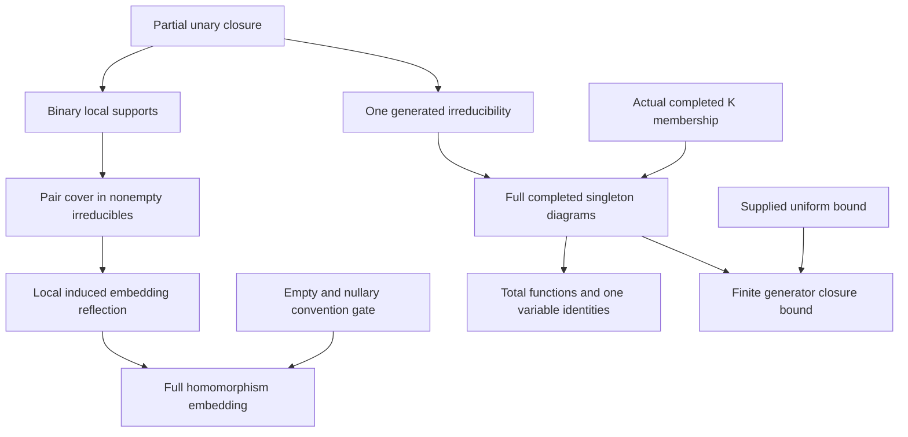

# Local irreducible supports and actual unary-generated HN diagrams

Generated from `module.json` by `tools/build_formalization_module.py`.

Source `490c3f36d85db5a0b3ced0598e6c431825254ec5`. **Human-expanded proof plan; no Lean code.**

Private B034: TWO Foundations III source results. First, in a finite total-unary structure with relations of arity at most two, each pair in a NONEMPTY closed irreducible lies in a singleton/displayed-binary generated support. Local induced embeddings therefore give embeddings on all NONEMPTY irreducibles. The unrestricted HE wording additionally needs the explicit empty/nullary convention gate A07; the literal all-empty/all-nullary reading has a counterexample. Second, for a finite PARTIAL-unary structure with ARBITRARY relations, domain-reflecting induced substructures and ACTUAL completed-K membership of every irreducible force actual completed one-generated diagrams, total unary functions, ONE-VARIABLE term identities and any supplied uniform closure bound. No completion of the whole input, HN Ramsey theorem, CCO, EPPA or hidden closure-bound theorem is assumed or proved.

The human article remains unchanged. Additional proof details are in
[PROOF_NOTES.md](PROOF_NOTES.md); the cross-track policy is in
[the formalization guide](../README.md). Source hashes are checked before
the index is regenerated. Graph validation is not proof verification.

## Source premises

**A01: Finite typed partial unary language.** C is a finite many-sorted structure in a finite language with unary function symbols and arbitrary relation symbols. Unary functions may initially have proper domains on their intended input sorts. No constants or other function arities are present. Sorts may be empty. Induced inclusions preserve and reflect all relation interpretations AND applicable function domains; if a function is defined at a retained point its actual value is retained.

**A02: Local-cover specialization.** ONLY for the local-cover branch, every named unary function of C is total on its intended input sort, and every relation has arity 0, 1 or 2. Functionally closed induced substructures use the same actual functions and relation diagrams. There is no completeness or class-membership condition on C.

**A03: Locally induced homomorphism.** ONLY for the local-embedding branch, f:C->H preserves sorts, all named unary functions and displayed relations, and is an induced embedding on EVERY member of the singleton/displayed-binary closed support family. Retain the source complete-target premise, though the proof does not use it. Each local embedding reflects ALL relation symbols, not only the symbol that generated its support.

**A04: Actual completed target class.** ONLY for the HN branch, K is a class of finite completed structures of the SAME signature, whose unary functions are total on their intended input sorts. An ACTUAL K member means its existing whole induced diagram, not the existence of a later completion. Membership up to isomorphism is interchangeable only if K is isomorphism-closed.

**A05: All irreducibles are actual K members.** ONLY for the HN branch, EVERY irreducible induced substructure of C is an ACTUAL K member. In particular this applies to any nonempty one-generated induced structure once irreducibility is proved. It does not assume C itself is complete, completable or in K.

**A06: Optional one-generated bound.** ONLY for the quantitative HN branch, m is a nonnegative integer such that EVERY completed ONE-GENERATED K member has at most m vertices. This is a supplied conditional bound; no uniform bound for arbitrary partial-unary inputs or arbitrary completed classes is manufactured here.

**A07: Empty irreducible and nullary reflection gate.** ONLY for extending the NONEMPTY local-embedding conclusion to every conventionally admitted irreducible, use at least ONE of: relational arities are positive; irreducibles are defined nonempty; OR the map reflects each nullary relation. Nonempty C already forces the third option from any singleton local embedding. If empty irreducibles AND nullary symbols are admitted, empty C needs that explicit nullary agreement. This gate is unnecessary for pair coverage and the HN branch.

## Definitions

| ID | Definition | Exact meaning | Source |
|---|---|---|---|
| D01 | Already-defined unary reachability closure | cl_C(B) consists of points reachable from some b in B by a finite composable chain of ALREADY-DEFINED named unary values; include the length-zero chain. Undefined transitions are not filled in. Sort tags follow each transition. | [source](../../sections/binary_unary_irreducible_local_cover.tex#L6) |
| D02 | Closed induced partial substructure | A subset S is closed when each named unary value defined in C at any applicable point of S lies in S. Equip S with exactly the induced relations and existing function domains/values. Its inclusion is a domain-reflecting embedding. | [source](../../sections/binary_unary_irreducible_local_cover.tex#L6) |
| D03 | Free-amalgam irreducibility | An induced structure D is irreducible if it has no free decomposition into two PROPER closed induced factors covering D and agreeing on their induced intersection. Relations and function graphs are exactly their unions. The base may be EMPTY. Empty-object conventions are separately recorded, not inferred. | [source](../../sections/binary_unary_irreducible_local_cover.tex#L6) |
| D04 | Finite local support family | H(D) contains cl_D({v}) for every v and cl_D({u,v}) for every ACTUALLY DISPLAYED binary tuple with u!=v, each with its FULL induced diagram. Duplicate supports may be identified. Diagonal binary tuples require no extra generator pair. | [source](../../sections/binary_unary_irreducible_local_cover.tex#L6) |
| D05 | Two omission unions | For distinct x,y in D with no common H(D) support define Ax=union{U in H(D): y notin U} and Ay=union{U in H(D): x notin U}. These are actual subsets, subsequently given the full induced diagrams. | [source](../../sections/binary_unary_irreducible_local_cover.tex#L6) |
| D06 | Local and global embedding contracts | An embedding is sort-preserving, injective and preserves/reflects every relation and every applicable function domain/value. A homomorphism-embedding is a homomorphism restricting to an embedding on every admitted source irreducible. The nonempty version quantifies only over nonempty irreducibles. | [source](../../sections/binary_unary_irreducible_local_cover.tex#L6) |
| D07 | Actual one-generated completed diagram | U_x=cl_C({x}) with its EXISTING full induced structure. Once U_x is an actual K member, it is completed with the same domain interpretations; a homomorphism to a different K structure or a completion of U_x is not this assertion. | [source](../../sections/binary_unary_irreducible_local_cover.tex#L225) |
| D08 | Well-typed ONE-VARIABLE unary term identity | A unary term is x followed by a finite type-correct composition of named unary functions, possibly the empty composition. An identity is t(x)=s(x) for terms with the SAME output sort and AT MOST that one free variable. Merely having unary operation symbols does not authorize equations using independent variables. | [source](../../sections/binary_unary_irreducible_local_cover.tex#L225) |
| D09 | Uniform completed one-generator bound | The optional m bounds the number of all vertices across sorts in every completed one-generated K member. A finite generator-set bound is to be DERIVED from a union of actual singleton closures. | [source](../../sections/binary_unary_irreducible_local_cover.tex#L225) |
| D10 | Full-diagram unary admissibility interface | For every x, its whole induced unary-generated diagram is isomorphic to an ACTUAL completed one-generated target member, including total functions, literal term equalities and ALL internal relations. In a terminal hidden instantiation this is def:typed-unary-admissible-source. It asserts no ambient completion or bounded-obstruction/Ramsey theorem. | [source](../../sections/binary_unary_irreducible_local_cover.tex#L225) |

## Proof claims and direct dependencies

Every row has a human proof expansion. Each still needs an actual Lean
Two independent elementary unary arguments share only closure definitions. Binary arity and totality belong to the local-cover branch; arbitrary relational arities and initially partial functions remain allowed in the HN branch. Source ambiguity and one-variable identity scope are explicit, not silently repaired.

| ID and claim | Scope | Direct providers | Proof note |
|---|---|---|---|
| C01: Reachability is the least closed containing subset | unary_closure | D01, D02 | N01 in [notes](PROOF_NOTES.md) |
| C02: Domain-reflecting induced inclusions are exactly closed restrictions | unary_closure | D02, A01 | N01 in [notes](PROOF_NOTES.md) |
| C03: Unions of unary closures and empty closure | unary_closure | C01, C02 | N01 in [notes](PROOF_NOTES.md) |
| C04: Unary closure is absolute inside closed induced substructures | unary_closure | C01, C02 | N01 in [notes](PROOF_NOTES.md) |
| C05: Singleton supports cover points and local tuple data | binary_local_cover | D04, C01, A02 | N02 in [notes](PROOF_NOTES.md) |
| C06: No common support gives exclusive endpoint witnesses | binary_local_cover | D05, C05 | N02 in [notes](PROOF_NOTES.md) |
| C07: The two omission unions are closed and cover D | binary_local_cover | C03, C05, C06 | N02 in [notes](PROOF_NOTES.md) |
| C08: Every displayed relation and function stays on one side | binary_local_cover | C05, C07, A02 | N02 in [notes](PROOF_NOTES.md) |
| C09: Exact diagram union contradicts irreducibility | binary_local_cover | C06, C07, C08, D03 | N02 in [notes](PROOF_NOTES.md) |
| C10: Pairwise local support cover of nonempty irreducibles | binary_local_cover | C09 | N02 in [notes](PROOF_NOTES.md) |
| C11: All local induced embedding hypotheses restrict literally to D | local_embedding | A03, C04, D04 | N03 in [notes](PROOF_NOTES.md) |
| C12: The map is injective on every nonempty irreducible | local_embedding | C10, C11 | N03 in [notes](PROOF_NOTES.md) |
| C13: Off-diagonal binary tuples reflect through a common support | local_embedding | C10, C11 | N03 in [notes](PROOF_NOTES.md) |
| C14: Unary predicates and repeated-coordinate binary tuples reflect | local_embedding | C11, C12 | N03 in [notes](PROOF_NOTES.md) |
| C15: Nonempty supports also reflect nullary relations | local_embedding | C11, A03 | N03 in [notes](PROOF_NOTES.md) |
| C16: Assemble an induced embedding on each nonempty irreducible | local_embedding | C12, C13, C14, C15, A02, A03, D06 | N03 in [notes](PROOF_NOTES.md) |
| C17: Source local consequence under the nonempty convention | local_embedding | C16, D06 | N03 in [notes](PROOF_NOTES.md) |
| C18: Full homomorphism-embedding after the explicit empty/nullary gate | local_embedding | C15, C17, A07 | N03 in [notes](PROOF_NOTES.md) |
| C19: Every already-defined one-generated closure is irreducible | HN_actual_diagram | C01, C02, D03 | N04 in [notes](PROOF_NOTES.md) |
| C20: Each one-generated full induced diagram is an actual K member | HN_actual_diagram | C19, A04, A05, D07 | N04 in [notes](PROOF_NOTES.md) |
| C21: All intended unary functions are already total in C | totality_and_terms | C20, A04, C02 | N05 in [notes](PROOF_NOTES.md) |
| C22: One-variable term evaluation remains inside the actual closure | totality_and_terms | D08, C20, C21, C04 | N05 in [notes](PROOF_NOTES.md) |
| C23: All valid ONE-VARIABLE typed identities transfer pointwise | totality_and_terms | C20, C22, D08 | N05 in [notes](PROOF_NOTES.md) |
| C24: Actual U_x is one-generated also as a completed K member | closure_bound | C01, C04, C20, C21, C22 | N06 in [notes](PROOF_NOTES.md) |
| C25: The supplied m bounds each actual singleton closure | closure_bound | C20, C24, D09 | N06 in [notes](PROOF_NOTES.md) |
| C26: Finite generator closure has size at most m times its generators | closure_bound | C03, C25 | N06 in [notes](PROOF_NOTES.md) |
| C27: Empty sources, empty generators and zero bound are handled | closure_bound | C03, C21, C23, C25, C26 | N06 in [notes](PROOF_NOTES.md) |
| C28: The full local admissibility interface is satisfied | HN_actual_diagram | C20, C21, C23, C24, D10 | N06 in [notes](PROOF_NOTES.md) |
| C29: HN source export keeps its conditional and independent scope | HN_actual_diagram | C19, C20, C21, C23, C25, C26, C27, C28 | N06 in [notes](PROOF_NOTES.md) |
| C30: Nullary and higher-relation counterexamples delimit the local branch | boundary | D04, D06, C10, C18 | N07 in [notes](PROOF_NOTES.md) |
| C31: Domain reflection and actual membership have distinct roles | boundary | C19, C20, C21 | N07 in [notes](PROOF_NOTES.md) |
| C32: Single-variable and unary-operation scope has real boundaries | boundary | C03, C19, C23, C26 | N07 in [notes](PROOF_NOTES.md) |

The precise quantified contracts are in `module.json`. Provider-before-consumer
order (including definitions and source premises):

`A01 → A02 → A03 → A04 → A05 → A06 → A07 → D01 → D02 → D08 → D09 → C01 → C02 → D03 → D04 → D07 → C03 → C04 → C05 → C19 → D05 → D06 → D10 → C06 → C11 → C20 → C07 → C15 → C21 → C08 → C22 → C31 → C09 → C23 → C24 → C10 → C25 → C28 → C12 → C13 → C26 → C14 → C27 → C32 → C16 → C29 → C17 → C18 → C30`

This order is one valid linearization; it does not require unrelated
branches to be proved sequentially. The full DAG is the `depends_on`
relation in `module.json`.

## Main proof branches

This is a coarse view of the claim DAG. Edges go from provider to consumer.

There are no mathematical provider imports and no external HN theorem calls.
The local-support argument requires total unary functions and relational arity at most two. HN singleton irreducibility permits initially partial unary functions and arbitrary relations.
The first source statement explicitly says NONEMPTY irreducible; full HE wording needs the empty/nullary convention gate. No source TeX is changed.
Actual completed membership transfers the WHOLE generated diagram. Completion alone and arbitrary multivariable identities do not suffice.
The downstream hidden unary-admissibility interface is established only after choosing K to be that completed hidden age. Its uniform m-bound remains a separate input.

## Article exports

| Existing source result | Sidecar proof claims |
|---|---|
| [`lem:typed-binary-irreducible-local-cover`](../../sections/binary_unary_irreducible_local_cover.tex#L5) | C10, C17, C18 |
| [`lem:hn-irreducible-forces-unary-admissible`](../../sections/binary_unary_irreducible_local_cover.tex#L224) | C20, C21, C23, C25, C26, C28, C29 |

## Internal implementation milestones

These tasks are proof milestones inside larger project assignments;
see the [peer-project allocation](../coordination/BOARD.md).

These are implementation tasks, not additional mathematical assumptions.

| Task | Earlier tasks | Acceptance |
|---|---|---|
| T01: Partial unary closure and induced inclusions | — | Implement genuine partial unary domains and domain-reflecting induced inclusions. Keep local arity/totality premises separate from the HN branch. Reflect all symbols on supports, including diagonal and nullary cases. Export the full HE claim only with the recorded empty/nullary gate. Transfer only one-variable typed identities, actual completed diagrams and a supplied conditional m-bound; do not assume an ambient completion or import an HN theorem. |
| T02: Closed local supports and exact free-decomposition contradiction | T01 | Implement genuine partial unary domains and domain-reflecting induced inclusions. Keep local arity/totality premises separate from the HN branch. Reflect all symbols on supports, including diagonal and nullary cases. Export the full HE claim only with the recorded empty/nullary gate. Transfer only one-variable typed identities, actual completed diagrams and a supplied conditional m-bound; do not assume an ambient completion or import an HN theorem. |
| T03: Local embedding reflection and empty/nullary gate | T01, T02 | Implement genuine partial unary domains and domain-reflecting induced inclusions. Keep local arity/totality premises separate from the HN branch. Reflect all symbols on supports, including diagonal and nullary cases. Export the full HE claim only with the recorded empty/nullary gate. Transfer only one-variable typed identities, actual completed diagrams and a supplied conditional m-bound; do not assume an ambient completion or import an HN theorem. |
| T04: Actual HN singleton diagrams, totality and typed term identities | T01 | Implement genuine partial unary domains and domain-reflecting induced inclusions. Keep local arity/totality premises separate from the HN branch. Reflect all symbols on supports, including diagonal and nullary cases. Export the full HE claim only with the recorded empty/nullary gate. Transfer only one-variable typed identities, actual completed diagrams and a supplied conditional m-bound; do not assume an ambient completion or import an HN theorem. |
| T05: Conditional size bound and full admissibility interface | T01, T04 | Implement genuine partial unary domains and domain-reflecting induced inclusions. Keep local arity/totality premises separate from the HN branch. Reflect all symbols on supports, including diagonal and nullary cases. Export the full HE claim only with the recorded empty/nullary gate. Transfer only one-variable typed identities, actual completed diagrams and a supplied conditional m-bound; do not assume an ambient completion or import an HN theorem. |
| T06: Scope boundary counterexamples | T01, T02, T03, T04, T05 | Implement genuine partial unary domains and domain-reflecting induced inclusions. Keep local arity/totality premises separate from the HN branch. Reflect all symbols on supports, including diagonal and nullary cases. Export the full HE claim only with the recorded empty/nullary gate. Transfer only one-variable typed identities, actual completed diagrams and a supplied conditional m-bound; do not assume an ambient completion or import an HN theorem. |

## Finite controls

- **K01.** Exhaustively enumerate bounded partial unary structures and compare one-generated reachability, closed induced pieces, actual-K conditions, irreducibility and the conditional union bound.
- **K02.** Bounded binary support/embedding maps and explicit nullary, higher relational arity, domain truncation, mere completion, multivariable identity and higher function arity counterexamples. These diagnostics do not certify all finite structures or HN/Ramsey/Lean results.

Run `python tools/check_unary_support_controls.py` from the manuscript directory.
The controls do not prove CCO or the general theorems.

## Return to the human articles

No required mathematical repair was found in this scoped pass. These
optional wording clarifications remain queued for a human article pass:

- **F01** ([source](../../sections/binary_unary_irreducible_local_cover.tex#L51)): The pair-cover assertion explicitly quantifies NONEMPTY irreducibles, while the consequence says EVERY irreducible and arity AT MOST TWO literally includes nullary relations. Empty C with mismatched nullary truth is a counterexample if empty structures count as irreducible. Specify positive relation arities or nonempty irreducibles, or state the separate nullary-reflection condition for the empty-source case. Retain the unconditional nonempty HE statement.
- **F02** ([source](../../sections/binary_unary_irreducible_local_cover.tex#L213)): Singleton supports handle unary predicates and repeated-coordinate binary tuples, while any common support must reflect EVERY symbol, not just its generating relation. Free-amalgam irreducibility allows an empty base. Complete target is unused. Add the singleton-tuple and empty-overlap sentences; make the all-symbol induced embedding convention explicit. Optionally remove the unnecessary complete-target premise in a separately reviewed edition.
- **F03** ([source](../../sections/binary_unary_irreducible_local_cover.tex#L251)): Unary term identities transfer only when t and s use the same single source variable. Actual membership gives the full induced diagram, not just identities or existence of a completion. The m-bound is a separate conditional input. Write well-typed t(x)=s(x), with at most one free variable, and point explicitly to actual full one-generated diagrams when invoking downstream unary admissibility.

The machine ledger records caller effects and affected claims. The source
review used two independent model review passes and parent synthesis;
it is not independent human or formal certification.
