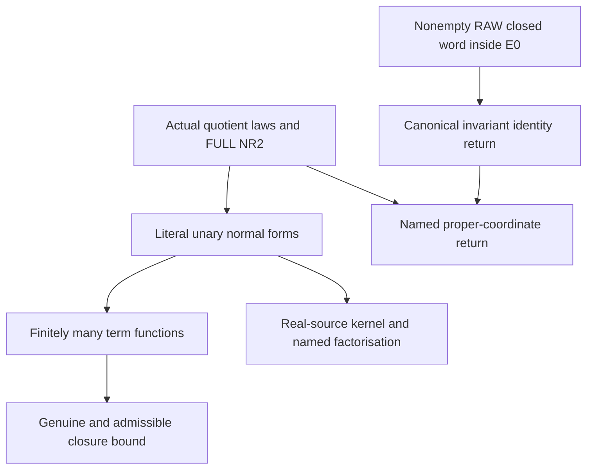

# Typed unary term functions, literal kernels and canonical quotient returns

Generated from `module.json` by `tools/build_formalization_module.py`.

Source `490c3f36d85db5a0b3ced0598e6c431825254ec5`. **Human-expanded proof plan; no Lean code.**

Private B052: four source10 results and QT-NF, ten definitions, 39 human claims and six tasks. Bound actual and unary-admissible one-generated closures through finitely many term FUNCTIONS; retain literal named factorisation and canonical RAW return holonomy. Malformed arbitrarily long transition cycles show why the restriction to unary-admissible HN inputs is essential. Generic group-action holonomy is separated from the old SAP/FULL NR2 named-coordinate upgrade. No hidden SAP, homogeneity or HN theorem is asserted.

The human article remains unchanged. Additional proof details are in
[PROOF_NOTES.md](PROOF_NOTES.md); the cross-track policy is in
[the formalization guide](../README.md). Source hashes are checked before
the index is regenerated. Graph validation is not proof verification.

## Source premises

**A01: Actual finite typed original and quotient interpretation.** M is a complete homogeneous finite binary relational source with finitely many nonempty transitive named real sorts and finitely many actual full-Aut pair orbitals per typed pair. Actual same-sort pair orbitals are symmetric; mixed-sort orbitals have their paired typed converses. Logical real identity is distinguished. Every hidden coordinate is the ACTUAL quotient by a represented proper meet-irreducible J, Id<J<Top. The interpreted finite language has real projections F_J, upward maps u_JK for represented J<=K, canonical quotient transitions and their inverse terms. Its functions are interpreted by actual quotients, not arbitrary total-unary operations. Named maps are equivariant.

**A02: Visible real SAP.** The actual original age has SAP over complete finite induced old bases. This is used only to prevent a nonzero proper quotient from transporting to an old real equality kernel. It does not imply arbitrary hereditary hidden SAP.

**A03: Terminal FULL no-relative-index-two gate.** On EVERY original named real sort the FULL invariant-equivalence lattice has no index-two interval. I05 identifies it with full RAW exact equivalences before transported MI kernels are declared represented/named. This is not merely a condition on an already represented sublattice. Neither semantic CCO nor hidden SAP is used in the present proofs.

**A04: Actual completed and unary-admissible finite hidden sources.** An actual completed member is a finite unary-closed induced substructure of the actual interpreted hidden structure, including quotient-only orphan substructures. A unary-admissible partial source has, for EVERY vertex, its FULL induced one-generated closure, including all functions, literal equalities and internal named binary data, isomorphic to an actual completed one-generated member. The whole partial source need not be completed or completable.

**A05: Separate generic closed RAW word.** Independently G acts transitively on nonempty typed carriers a_i. Each P_i:a_(i-1)->a_i is a NONEMPTY G-invariant actual relation, n>=1, a_n is literally a_0, and the equality-inclusive existential RAW product P_1;...;P_n is contained in a G-invariant equivalence E_0. Every coarser J>=E_0 is invariant. For definability conclusions the relations, E_0 and J have given parameter-free first-order definitions; finite named full-Aut orbitals discharge this in the actual source. No SAP/CCO/faithfulness or naming is supplied by this generic premise.

**A06: Standard unary irreducibility test for the diagnostic.** A unary-functional substructure is closed under all named unary functions. An irreducible structure is not a free amalgam of two proper substructures; a homomorphism-embedding is injective on every irreducible substructure. This is the elementary condition tested by the malformed-cycle diagnostic, without importing a published HN theorem. HN applicability and its three existing external receiving bindings remain outside this package.

## Imported theorem contracts

These are named provider obligations for the receiving Lean project,
not new axioms or claims of compiled imports.

| ID and source | Contract | Current provider status |
|---|---|---|
| I01: [`lem:typed-transition-composition-normal-form`](../../sections/v27/07_typed_raw_strong_transition.tex#L660) | Literal RAW transition composition and upward interchange, finite induced term FUNCTIONS, and represented membership after actual FULL NR2/noncollapse. Use these exact named-coordinate contracts without transporting an arbitrary invariant kernel into the language. | HUMAN_EXPANDED_NOT_LEAN |
| I02: [`lem:no-real-algebraic-transition`](../../sections/v27/07_typed_raw_strong_transition.tex#L572) | Under visible original SAP a transported nonzero proper quotient stays nonzero and proper. No generic group-action noncollapse or hidden SAP is inferred. | HUMAN_EXPANDED_NOT_LEAN |
| I03: [`lem:typed-quotient-transport`](../../sections/typed_invariant_quotient_transport.tex#L15) | Canonical equivariant quotient bijections and upper-invariant-interval isomorphisms, preserving proper MI and composing on the LITERAL middle kernel. Actual finite full-Aut orbital naming supplies definability; arbitrary-G invariance alone does not. | HUMAN_EXPANDED_NOT_LEAN |
| I04: [`lem:foundational-typed-return-holonomy`](../../sections/typed_invariant_quotient_transport.tex#L84) | A nonempty typed RAW closed word contained in E0 canonically labels every position by a0/E0. Exact prefix/factor kernels, compatible quotient bijections and identity holonomy hold simultaneously for all coarser invariant J. Generic objects are invariant, not automatically named/full RAW exact. | HUMAN_EXPANDED_NOT_LEAN |
| I05: [`lem:typed-all-invariant-equivalences-raw-word`](../../sections/terminal_invariant_raw_exact.tex#L5) | FULL original NR2 supplies actual full RAW words for EVERY invariant equivalence. This identifies transported full MI with represented exact MI; exclude the separate distributivity claim C28. | HUMAN_EXPANDED_NOT_LEAN |
| I06: [`lem:typed-identity-transport-redundant`](../../sections/v27/07_typed_raw_strong_transition.tex#L618) | A same-sort RAW transport containing real Id and quotient-functional over J induces the EXISTING identity on J-classes, with J^R=J. Do not introduce an identity-labelled STRONG atom. | HUMAN_EXPANDED_NOT_LEAN |

## Definitions

| ID | Definition | Exact meaning | Source |
|---|---|---|---|
| D01 | Literal finite coordinate language | Real sorts a, actual quotients B_(a,J), projections F_J, upward maps u_JK, actual canonical transitions pi_(R,J) and existing identity terms. All maps carry literal domain/codomain objects. | [source](../../sections/v27/10_typed_unary_terms_return.tex#L67) |
| D02 | Term function rather than syntax | A unary term is composable syntax; its term function is its actual interpreted map in the fixed hidden structure. Distinct terms can denote the same function, including repeated transition-inverse loops. | [source](../../sections/v27/10_typed_unary_terms_return.tex#L67) |
| D03 | Upward inversion count | For a source-to-target word count pairs consisting of a transition and an upward map occurring later. An adjacent transition/upward interchange reduces this nonnegative integer by one. | [source](../../sections/v27/10_typed_unary_terms_return.tex#L67) |
| D04 | Normal-form index set and explicit bound | For each real source index the real identity and all pairs (represented source kernel K, actual typed relation T from that original sort). For coordinate source B_(a,J), index all (represented K>=J, actual T), including identities as already existing functions. These finite sets overcount the possible normal-form functions. m_typ is the maximum of their cardinalities over all source hidden sorts, enlarged to at least one. | [source](../../sections/v27/10_typed_unary_terms_return.tex#L67) |
| D05 | Unary-admissible partial input | For every vertex v, cl_C(v) with its FULL induced hidden diagram is isomorphic to an ACTUAL completed one-generated member. This includes binary data within the closure and all unary term equalities, not just cardinality or unary closedness. | [source](../../sections/v27/10_typed_unary_terms_return.tex#L2) |
| D06 | Transition-closed root signature | For an actual guarded root pair x D y and represented J with D;D^op subset J, retain pi_(D,J)(F_J(x))=F_(J^D)(y) and full functional closure. If D is a theta intersection, additionally retain each branch-forced identity at its own quotient-functional kernel. | [source](../../sections/v27/10_typed_unary_terms_return.tex#L125) |
| D07 | Malformed cyclic source | On quotient sorts QA,QB use x_i,y_i, i modulo n>=2, f(x_i)=y_i and g(y_i)=x_(i+1); no real roots or displayed binary orbitals. Any additional unary symbols in the actual common-block signature are interpreted consistently with their indicated source/target; nontrivial extra functions do not exist in this diagnostic. | [source](../../sections/v27/10_typed_unary_terms_return.tex#L21) |
| D08 | Real-source kernel K_tau | For real identity tau use actual Id_a. Otherwise a literal normal form theta composed F_K has K_tau=K, a represented proper MI; theta is an actual named bijection or existing quotient identity. | [source](../../sections/v27/10_typed_unary_terms_return.tex#L150) |
| D09 | Generic prefixes and canonical labels | R_0=Id_(a0), R_i=P_1;...;P_i. For y at position i, lambda_i(y) is the E0-class of ANY R_i-predecessor; a common suffix proves well-definedness. All position labels live in the SAME a0/E0. | [source](../../sections/v27/10_typed_unary_terms_return.tex#L244) |
| D10 | Coarsened return kernels | For J>=E0 put J_i=R_i^op;J;R_i. The corresponding quotient labels are lambda_i followed by a0/E0->a0/J. Adjacent maps use exactly these J_i on both incident macro sides. | [source](../../sections/v27/10_typed_unary_terms_return.tex#L244) |

## Proof claims and direct dependencies

Every row has a human proof expansion. Each still needs an actual Lean
statement and proof. The actual terminal signature is finite WITH its quotient identities, not an arbitrary interpretation of finitely many unary symbols. Quotient identity is an existing term, never a STRONG old equality atom. Named represented proper kernels are strictly above real Id and below Top. Generic action statements supply invariant kernels only.

| ID and claim | Scope | Direct providers | Proof note |
|---|---|---|---|
| C01: Actual invariant relations are nonempty serial and coserial | support | A01 | N01 in [notes](PROOF_NOTES.md) |
| C02: Terminal representation is discharged before named transport | support | A01, A03, I05 | N01 in [notes](PROOF_NOTES.md) |
| C03: Proper nonzero MI objects remain named under transport and pullback | support | A01, A02, C02, I02, I03 | N01 in [notes](PROOF_NOTES.md) |
| C04: Relations sharing an atom have the same canonical quotient map | signature | A01, C01, I03 | N01 in [notes](PROOF_NOTES.md) |
| C05: Direct and branch-forced root identities are simultaneously consistent | signature | D06, C03, C04 | N01 in [notes](PROOF_NOTES.md) |
| C06: One upward interchange is a literal pointwise equality | normal_form | D01, C03, I01, I03 | N02 in [notes](PROOF_NOTES.md) |
| C07: The normalization rewrite terminates | normal_form | D02, D03, C06 | N02 in [notes](PROOF_NOTES.md) |
| C08: Consecutive upward maps collapse to an initial quotient map | normal_form | A01, D01, C03, C07 | N02 in [notes](PROOF_NOTES.md) |
| C09: Transition-only words collapse to one actual RAW relation | normal_form | C01, C03, I01, I03 | N02 in [notes](PROOF_NOTES.md) |
| C10: Identity-containing RAW returns reduce to an existing identity | normal_form | C09, I06 | N02 in [notes](PROOF_NOTES.md) |
| C11: Literal real- and coordinate-source normal forms | normal_form | C07, C08, C09, C10 | N02 in [notes](PROOF_NOTES.md) |
| C12: There are finitely many normal-form functions from every sort | closure | A01, D04, C11 | N02 in [notes](PROOF_NOTES.md) |
| C13: Every actual one-generated closure has at most m_typ values | closure | A04, C12 | N03 in [notes](PROOF_NOTES.md) |
| C14: Unary-admissible sources inherit the actual bound one vertex at a time | closure | A04, D05, C13 | N03 in [notes](PROOF_NOTES.md) |
| C15: Finite language alone is not the closure theorem | boundary | C12, C14 | N03 in [notes](PROOF_NOTES.md) |
| C16: The common-block diagnostic has genuine old SAP and CCO | malformed | A06 | N04 in [notes](PROOF_NOTES.md) |
| C17: One malformed unary generator reaches the entire 2n-cycle | malformed | D07, C16 | N04 in [notes](PROOF_NOTES.md) |
| C18: The cyclic source is irreducible for unary closed substructures | malformed | A06, C17 | N04 in [notes](PROOF_NOTES.md) |
| C19: Every completion homomorphism collapses consecutive x-points | malformed | A06, C16, C18 | N04 in [notes](PROOF_NOTES.md) |
| C20: Arbitrary unary-closed inputs have no bounded closed obstruction size | malformed | C17, C19 | N04 in [notes](PROOF_NOTES.md) |
| C21: The malformed family violates precisely one-generated admissibility | boundary | D05, C18, C19, C20 | N04 in [notes](PROOF_NOTES.md) |
| C22: Real identity has exactly the equality kernel | kernel | A01, D08 | N05 in [notes](PROOF_NOTES.md) |
| C23: A proper coordinate normal form has exactly kernel K | kernel | D08, C03, C11 | N05 in [notes](PROOF_NOTES.md) |
| C24: Coordinate-term normal-form source export is literal | kernel | C22, C23, C11 | N05 in [notes](PROOF_NOTES.md) |
| C25: An equivariant quotient bijection gives equality of stabilizers | kernel | C22, C23, A01 | N05 in [notes](PROOF_NOTES.md) |
| C26: The real identity is excluded by a nonzero forced coordinate | factorisation | A01, C22 | N05 in [notes](PROOF_NOTES.md) |
| C27: Forced terms factor through the literal named upward map | factorisation | C10, C11, C23, C26 | N05 in [notes](PROOF_NOTES.md) |
| C28: A common suffix canonically labels every prefix of a generic return | return | A05, D09, I04 | N06 in [notes](PROOF_NOTES.md) |
| C29: Prefix kernels are exact actual transported equivalences | return | C28, I04 | N06 in [notes](PROOF_NOTES.md) |
| C30: Each factor uses the SAME kernel on its intermediate macro side | return | C28, C29, I04 | N06 in [notes](PROOF_NOTES.md) |
| C31: Canonical closed-word holonomy is literal identity | return | C28, C29, C30, I04 | N06 in [notes](PROOF_NOTES.md) |
| C32: All coarser J return simultaneously and compatibly | return | A05, D10, C28, C30, C31, I04 | N06 in [notes](PROOF_NOTES.md) |
| C33: Generic first-order wording requires supplied definitions | return | A05, C29, C32, I04 | N06 in [notes](PROOF_NOTES.md) |
| C34: Actual terminal coarser MI kernels are named proper coordinates | named_return | A01, A02, C02, C03, C32, I02, I03 | N06 in [notes](PROOF_NOTES.md) |
| C35: Each actual return edge has its existing literal named term | named_return | C04, C30, C34, I06 | N06 in [notes](PROOF_NOTES.md) |
| C36: Typed return-transport source export retains two logical stages | named_return | C28, C29, C30, C31, C32, C33, C34, C35 | N06 in [notes](PROOF_NOTES.md) |
| C37: Arbitrary subgroup invariance is not represented full-Aut data | boundary | C25, C33, C34 | N07 in [notes](PROOF_NOTES.md) |
| C38: Finite term and return controls are diagnostics only | boundary | C14, C21, C27, C36 | N07 in [notes](PROOF_NOTES.md) |
| C39: Empty transition parts and short closed words retain actual identities | boundary | C10, C11, C22, C31, A05 | N07 in [notes](PROOF_NOTES.md) |

The precise quantified contracts are in `module.json`. Provider-before-consumer
order (including definitions and source premises):

`A01 → A02 → A03 → A04 → A05 → A06 → D01 → D02 → D03 → D04 → D05 → D06 → D07 → D08 → D09 → D10 → I01 → I02 → I03 → I04 → I05 → I06 → C01 → C02 → C16 → C22 → C28 → C03 → C04 → C17 → C26 → C29 → C05 → C06 → C09 → C18 → C30 → C07 → C10 → C19 → C31 → C08 → C20 → C32 → C11 → C21 → C33 → C34 → C12 → C23 → C35 → C39 → C13 → C24 → C25 → C27 → C36 → C14 → C37 → C15 → C38`

This order is one valid linearization; it does not require unrelated
branches to be proved sequentially. The full DAG is the `depends_on`
relation in `module.json`.

## Main proof branches

This is a coarse view of the claim DAG. Edges go from provider to consumer.

Four source10 results and QT-NF; arbitrary total-unary partial sources are explicitly excluded from the closure theorem.
Only actual original SAP and FULL NR2 enter the named upgrade. Generic return needs neither SAP nor CCO and preserves literal canonical quotient labels.
Malformed long cycles are a boundary diagnostic for HN input admissibility, not an external HN theorem application or a Ramsey counterexample.

## Article exports

| Existing source result | Sidecar proof claims |
|---|---|
| [`lem:typed-unary-closure-bound`](../../sections/v27/10_typed_unary_terms_return.tex#L66) | C13, C14 |
| [`lem:typed-coordinate-normal-form`](../../sections/v27/10_typed_unary_terms_return.tex#L149) | C24, C25 |
| [`cor:typed-forced-term-factorisation`](../../sections/v27/10_typed_unary_terms_return.tex#L216) | C27 |
| [`lem:typed-return-transport`](../../sections/v27/10_typed_unary_terms_return.tex#L244) | C36 |

Auxiliary source equations (not additional numbered results):

- [`eq:typed-coordinate-normal-form`](../../sections/v27/10_typed_unary_terms_return.tex#L158): C24

## Internal implementation milestones

These tasks are proof milestones inside larger project assignments;
see the [peer-project allocation](../coordination/BOARD.md).

These are implementation tasks, not additional mathematical assumptions.

| Task | Earlier tasks | Acceptance |
|---|---|---|
| T01: Actual coordinates, named transport and root signatures | — | Retain actual interpreted quotient objects, named inverse transitions and FULL invariant NR2 before declaring transported kernels represented. Bound term functions, never syntax or arbitrary total-unary partial inputs. Use literal RAW composition and existing identities. Forced factorisation is a named term; generic holonomy keeps nonempty factors and the same canonical intermediate kernels. No hidden SAP or external-provider conclusion follows. |
| T02: Literal normalization and finite function index | T01 | Retain actual interpreted quotient objects, named inverse transitions and FULL invariant NR2 before declaring transported kernels represented. Bound term functions, never syntax or arbitrary total-unary partial inputs. Use literal RAW composition and existing identities. Forced factorisation is a named term; generic holonomy keeps nonempty factors and the same canonical intermediate kernels. No hidden SAP or external-provider conclusion follows. |
| T03: Genuine closure bound and malformed partial-input guard | T01, T02 | Retain actual interpreted quotient objects, named inverse transitions and FULL invariant NR2 before declaring transported kernels represented. Bound term functions, never syntax or arbitrary total-unary partial inputs. Use literal RAW composition and existing identities. Forced factorisation is a named term; generic holonomy keeps nonempty factors and the same canonical intermediate kernels. No hidden SAP or external-provider conclusion follows. |
| T04: Real-source kernels, stabilizers and forced factorisation | T01, T02 | Retain actual interpreted quotient objects, named inverse transitions and FULL invariant NR2 before declaring transported kernels represented. Bound term functions, never syntax or arbitrary total-unary partial inputs. Use literal RAW composition and existing identities. Forced factorisation is a named term; generic holonomy keeps nonempty factors and the same canonical intermediate kernels. No hidden SAP or external-provider conclusion follows. |
| T05: Generic RAW return and definability boundary | — | Retain actual interpreted quotient objects, named inverse transitions and FULL invariant NR2 before declaring transported kernels represented. Bound term functions, never syntax or arbitrary total-unary partial inputs. Use literal RAW composition and existing identities. Forced factorisation is a named term; generic holonomy keeps nonempty factors and the same canonical intermediate kernels. No hidden SAP or external-provider conclusion follows. |
| T06: Terminal named return and all boundary contracts | T01, T02, T03, T04, T05 | Retain actual interpreted quotient objects, named inverse transitions and FULL invariant NR2 before declaring transported kernels represented. Bound term functions, never syntax or arbitrary total-unary partial inputs. Use literal RAW composition and existing identities. Forced factorisation is a named term; generic holonomy keeps nonempty factors and the same canonical intermediate kernels. No hidden SAP or external-provider conclusion follows. |

## Finite controls

- **K01.** Finite actual coordinate language: close all induced term functions, compare normal forms pointwise, verify real kernels/stabilizers and named forced factorisations, and show arbitrarily repeated inverse syntax has one function.
- **K02.** Finite RAW two-sort closed words and EVERY coarser equivalence: verify prefix/factor kernel bounds, exact adjacent canonical maps and literal identity holonomy. Noncontained closed words retain nonidentity holonomy as a guard.
- **K03.** Malformed quotient cycles of several sizes: one-generated closure is the full cycle, every proper nonempty subset fails unary closedness, genuine inverse identities force collapse, and no real or displayed binary data is needed.

Run `python tools/check_unary_terms_return_controls.py` from the manuscript directory.
The controls do not prove CCO or the general theorems.

## Return to the human articles

No required mathematical repair was found in this scoped pass. These
optional wording clarifications remain queued for a human article pass:

- **F01** ([source](../../sections/v27/10_typed_unary_terms_return.tex#L245)): The return statement uses the standing convention that all word factors are nonempty actual invariant RAW relations and n>=1. Without nonemptiness a contained empty product relation would not induce quotient bijections. Optionally repeat NONEMPTY actual RAW factors and n>=1 in the return lemma statement, and note that the generic invariant stage is distinct from terminal represented namedness.

The machine ledger records caller effects and affected claims. The source
review used two independent model review passes and parent synthesis;
it is not independent human or formal certification.
