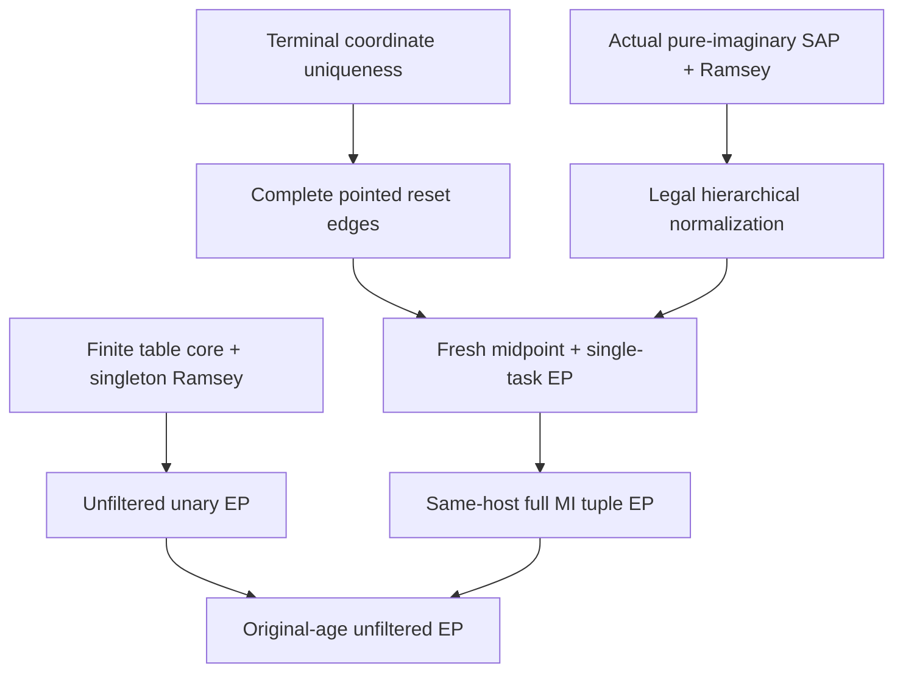

# Unfiltered phase labels, synchronized terminal orders and same-host tuple expansion property

Generated from `module.json` by `tools/build_formalization_module.py`.

Source `490c3f36d85db5a0b3ced0598e6c431825254ec5`. **Human-expanded proof plan; no Lean code.**

Private B064: all EIGHT unfiltered-EP source results, THREE auxiliary equations, sixteen definitions, 112 human claims and fourteen tasks. An independent finite-template singleton Ramsey criterion gives unary EP exactly for core type tables. Actual terminal symmetry gives unique coordinate values, trivial return holonomy and one complete pointed reset-edge type. The genuine PURE-IMAGINARY hidden SAP source supplies ordered fresh midpoints over the entire actual closed pair base; one fixed full Ramsey provider and legal reversal prove each relative task EP. Orders add no functions, so precise finite-chain EP composition applies. All actual MI tuple coverage, distributivity/cofinality, canonical fine supports and SAME-HOST lifting hypotheses are discharged before visible EP. The genuine unfiltered table is core, so the explicit final AP+HOM-CCO expansion has Ramsey and EP without deleting labels. The finite-original case is separately completed using actual unique terminal tags and zero-coordinate roots. No new external theorem, source TeX edit, EPPA or Lean certification.

The human article remains unchanged. Additional proof details are in
[PROOF_NOTES.md](PROOF_NOTES.md); the cross-track policy is in
[the formalization guide](../README.md). Source hashes are checked before
the index is regenerated. Graph validation is not proof verification.

## Source premises

**A01: Independent finite pair-local template setting.** K is a hereditary finite complete atomic binary age with retained original sorts. U_T is a reasonable reduct-surjective finite unary expansion defined exactly by its realized original-atom/type-pair tables R_a, with EVERY listed pair realized on distinct actual vertices, including repeated labels. T consists of realized complete labels. R is a hereditary reasonable reduct-surjective Ramsey expansion of U_T with JEP and exactly ONE actual expanded one-point shape per label: every vertex induces that shape, so its singleton embeddings are legitimate. Template endomorphisms preserve original sorts and every R_a; the individual new labels are NOT constants or unary predicates of the TEMPLATE.

**A02: Independent symmetric equivariant-coordinate setting.** G acts transitively on S and every G-invariant binary relation on S is symmetric. The two displayed maps tau,sigma:S->B are equivariant surjections onto the SAME transitive G-set B. No CCO, Ramsey, SAP, finiteness or terminality is assumed for the kernel/involution part.

**A03: Conditional terminality for coordinate uniqueness only.** Only for the final uniqueness implication in the preceding generic setting, there is NO invariant equivalence strictly above the common kernel whose relative index over that kernel is finite and greater than one. A finite strict interval is excluded, not merely a represented sublattice or a no-index-two condition on unnamed objects.

**A04: Bound actual terminal clone and pure-imaginary instance.** Mdagger=Qdagger x N is an actual finite-sorted FULL triangle-defined homogeneous symmetric binary SAP+HOM-CCO terminal clone source. Every strict cover in EVERY FULL current invariant-equivalence lattice has infinite relative index, including Top covers. Owner sorts are infinite in this parameterized branch. The actual hidden signature has proper nonidentity represented MI quotient sorts, all complete actual mixed semantic cylinders and equivariant unary projections/upward maps/quotient transitions with inverses. Named functions are total on their prescribed input sorts and undefined off-sort; no proper quotient map returns to a real sort. Choose finite meet-representing MI charts for each K_s. Order assertions use fixed hidden SORT priority and transition-synchronized within-cut fibre orders with parent-coordinate lex reconstruction; existence of their legal Ramsey class is proved, not assumed as an EP input. This is a BOUND intermediate instance, discharged from A06 for the main infinite theorem.

**A05: Independent abstract same-host tuple-EP parameters.** For the abstract implication only, H^o->H is a reasonable reduct-surjective precompact unary-functional/relational expansion with EP and a full finite tuple code. The four stated contracts hold: canonical unexpanded generated supports; cofinal finite E with h(N(E))=E; EVERY allowed full visible expansion lifts to that SAME E; and the natural ALL-embeddings correspondence with original fine-colour recovery. These are parameters of the abstract theorem, discharged concretely in C73-C84 rather than assumed for the final application.

**A06: Original infinite one-sort AP source.** Q is countably infinite, transitive and homogeneous in a finite complete symmetric binary language of actual pair orbitals, with ordinary age AP and semantic HOM CCO. No old SAP, terminality, finite-packet MI assumption, Ramsey expansion or expansion property is an input. The actual genuine maximal-character safe terminalisation, not arbitrary unary labels, is the recipe used in the main construction.

**A07: Separate finite original source.** For the finite-original case, Q is a nonempty FINITE transitive homogeneous complete symmetric binary AP+HOM-CCO source. Apply the same actual infinite-clone cover and genuine finite maximal-character terminalisation; the owner quotient remains this finite Q. This case does not satisfy A06 or the infinite-owner A04 parameter and is proved separately.

**A08: Relational finite-core fallback only.** For the ancillary minimum-rank core-filter remark, the provider is relational (or otherwise its retained-label induced restrictions are actual closed substructures). This is the explicitly relational fallback in the source, not an extra premise of the genuine unfiltered construction.

## Imported theorem contracts

These are named provider obligations for the receiving Lean project,
not new axioms or claims of compiled imports.

| ID and source | Contract | Current provider status |
|---|---|---|
| I01: [`lem:ramsey-clone-stability`](../../sections/ramsey_ap_from_clones.tex#L60) | The genuine safe terminal clone tower descends to finite reasonable owner labels with infinite owner sorts; strict C05 separately gives K_s as the LEAST nonidentity FULL invariant equivalence in every clone-saturated current transitive sort. | HUMAN_EXPANDED_NOT_LEAN |
| I02: [`thm:ep-ap-marked-completion`](../../sections/ep_safe_ap_character_completion.tex#L376) | Actual finite complete marked objects are precisely old-age diagrams satisfying the full character pair masks. Any prescribed legal marking extends along the SAME old embedding; the genuine homogeneous marked limit has unchanged old reduct. Arbitrary locally invented old atoms or a single arbitrary global seed are not substituted. | HUMAN_EXPANDED_NOT_LEAN |
| I03: [`thm:ramsey-general-ap`](../../sections/ramsey_ap_from_clones.tex#L30) | Use the proved AP-to-actual-terminal construction and canonical fine full-code setting, retaining its explicit NEW-source substitutions. The old theorem arrows are not a shortcut for the new hierarchical ordered age. | HUMAN_EXPANDED_NOT_LEAN |
| I04: [`lem:typed-unary-closure-bound`](../../sections/v27/10_typed_unary_terms_return.tex#L66) | Finite hidden closures have a uniform size bound, and strict C12 gives finitely many ACTUAL unary term FUNCTIONS on EVERY hidden input sort, including proper coordinate sorts. | HUMAN_EXPANDED_NOT_LEAN |
| I05: [`lem:typed-coordinate-normal-form`](../../sections/v27/10_typed_unary_terms_return.tex#L149) | A real-source term is an actual quotient projection with a proper represented MI kernel followed by a named equivariant quotient bijection, or the real identity. Compose a quotient-start term with its real projection before applying this theorem. | HUMAN_EXPANDED_NOT_LEAN |
| I06: [`lem:no-real-algebraic-transition`](../../sections/v27/07_typed_raw_strong_transition.tex#L572) | No actual proper quotient-coordinate sort has a nonidentity unary transition/upward map into a real sort. Its literal pure-imaginary sort restriction is therefore unary closed. | HUMAN_EXPANDED_NOT_LEAN |
| I07: [`thm:internal-ramsey-terminal`](../../sections/v27/18_unary_hn_transfer.tex#L1) | Use ONLY strict C30 actual proof support: the ENTIRE hereditary hidden age has SAP, including orphan-only and empty closed bases. This SAP import is kept separate from the ordered Ramsey support I30; no Ramsey or EP output supplies a fresh midpoint. | HUMAN_SUPPORT_PROOF_NOT_LEAN |
| I08: [`lem:foundational-ramsey-sort-restriction`](../../sections/reset_midpoint_order_ep.tex#L13) | A full induced restriction to unary-closed named sorts inherits Ramsey, JEP and supplied SAP; deleted sorts stay empty. It is not an arbitrary relational reduct. | HUMAN_EXPANDED_NOT_LEAN |
| I09: [`lem:foundational-ramsey-normalization`](../../sections/reset_midpoint_order_ep.tex#L69) | A legal same-universe, same-map strict idempotent endofunctor gives a hereditary Ramsey fixed-object class, with JEP when supplied. No surjectivity on embedding sets or generic ordered SAP assertion is assumed. | HUMAN_EXPANDED_NOT_LEAN |
| I10: [`lem:foundational-hierarchical-order-normalization`](../../sections/reset_midpoint_order_ep.tex#L99) | On actual finite distributive quotient lattices, canonical commuting upward/transition maps and trivial return holonomy, the hierarchical normalizer is legal, same-map idempotent and permits SINGLE task reversal with earlier coarser tasks fixed. Only FIBRE orders are synchronized; global transition monotonicity is not asserted. | HUMAN_EXPANDED_NOT_LEAN |
| I11: [`thm:typed-relative-reset`](../../sections/v27/08_typed_terminal_reset_equivalences.tex#L881) | Every actual represented NONZERO terminal MI cut J<Jplus has ONE complete symmetric quotient semantic cylinder m in Jplus minus J, with BOTH m*m=(Jplus)^circ in STRONG diversity and m;m=Jplus in FULL RAW semantics. m may contain many old fine atoms. | HUMAN_EXPANDED_NOT_LEAN |
| I12: [`thm:abstract-reset-order-EP`](../../sections/reset_midpoint_order_ep.tex#L212) | Relative single-task EP follows from ONE common full hereditary Ramsey/JEP lift class, legal total reversal over the same earlier reduct, ONE complete POINTED ordered reset-edge type and induced fresh-midpoint extensions. Intermediate partially ordered classes need not be Ramsey. | HUMAN_EXPANDED_NOT_LEAN |
| I13: [`lem:abstract-fresh-reset-midpoint`](../../sections/reset_midpoint_order_ep.tex#L333) | A finite permitted closed midpoint witness over the EXACT actual pointed pair closure and an actual ordered SAP extension produce a fresh induced midpoint over the whole given object. These hypotheses must be discharged; raw menu multiplication alone is insufficient. | HUMAN_EXPANDED_NOT_LEAN |
| I14: [`lem:foundational-relative-EP-composition`](../../sections/reset_midpoint_order_ep.tex#L377) | Compose the forall-expanded-target/exists-fixed-host/forall-competing-expansion EP statements only with the proved inherited-image closedness gate A14. Every level here retains all functions/domains and adds only relations/orders, so that gate is automatic. | HUMAN_EXPANDED_NOT_LEAN |
| I15: [`lem:foundational-MI-coordinate-cofinal`](../../sections/exact_lattice_crt.tex#L68) | In a FINITE DISTRIBUTIVE lattice, K=meet selected J_i<=J with J MI implies some selected J_i<=J. It is a meet-PRIME consequence, not a theorem of generic finite MI separation. | HUMAN_EXPANDED_NOT_LEAN |
| I16: [`lem:foundational-root-cover-cofinal`](../../sections/full_code_tuple_ep_transfer.tex#L129) | Actual ambient unary-term root coverage and finite normal forms produce finite E extending any hidden D with h(N(E))=E, including orphan/empty cases. No Ramsey or EP premise is used. | HUMAN_EXPANDED_NOT_LEAN |
| I17: [`lem:foundational-same-host-code`](../../sections/full_code_tuple_ep_transfer.tex#L182) | For ANY bound full-root-generated E and EVERY allowed visible full-code expansion of N(E), its canonical generated code transports to an allowed hidden expansion of THAT SAME unexpanded E. No cofinality/EP/Ramsey is assumed for this local lemma. | HUMAN_EXPANDED_NOT_LEAN |
| I18: [`lem:foundational-full-code-embeddings`](../../sections/full_code_tuple_ep_transfer.tex#L52) | ALL marked same-root/cross-root term equality, function-domain/value, fine relation and order codes reconstruct the generated support and give the natural bijection of ALL visible and hidden embedding maps. | HUMAN_EXPANDED_NOT_LEAN |
| I19: [`thm:foundational-cofinal-tuple-EP`](../../sections/full_code_tuple_ep_transfer.tex#L241) | The abstract four-contract same-host full-code interface plus the supplied hidden EP and reasonable/precompact setting gives visible EP, with ONE host chosen before ANY competing expansion. | HUMAN_EXPANDED_NOT_LEAN |
| I20: [`thm:ramsey-tuple-readout`](../../sections/full_code_tuple_ep_transfer.tex#L103) | A hidden embedding-Ramsey class transfers to its hereditary full-code age through the exact ALL-embeddings bijection. It does not require EP, cofinal root coverage or visible SAP. | HUMAN_EXPANDED_NOT_LEAN |
| I21: [`lem:ramsey-mi-domain`](../../sections/ramsey_ap_from_clones.tex#L113) | Actual compatible MI tuples are exactly the original owner points; their qf domain remains valid on orphan-only finite hidden hosts. | HUMAN_EXPANDED_NOT_LEAN |
| I22: [`lem:ramsey-singleton-recovery`](../../sections/ramsey_ap_from_clones.tex#L168) | The intersection of ALL actual mixed spectra recovers the singleton original fine atom; equal roots return the clone marker as VISIBLE equality. Coincident hidden coordinates use their full equivalence diversity support. | HUMAN_EXPANDED_NOT_LEAN |
| I23: [`thm:ep-automatic-core`](../../sections/expansion_property_automatic_core.tex#L134) | For the genuine maximal-exact-character terminal tower on one original sort, complete original bipartite-atom separation makes every table endomorphism injective and hence an automorphism. No labels are filtered and individual terminal labels are not constants of the template. | HUMAN_EXPANDED_NOT_LEAN |
| I24: [`thm:finite-cover-elimination`](../../sections/v27/06_legacy_finite_covers.tex#L574) | The actual full maximal-character construction terminalizes the symmetric clone SAP+HOM-CCO source by finitely many reasonable reduct-surjective unary steps while preserving actual old reduct, homogeneity and full current orbitals. Keep its actual/FULL-sector qualifications. | HUMAN_EXPANDED_NOT_LEAN |
| I25: [`thm:internal-clone-sap`](../../sections/ramsey_clone_sap.tex#L3) | The actual Q x N cover of a homogeneous AP+HOM-CCO triangle-constrained source is homogeneous SAP+HOM CCO, including FINITE Q; K=Id union c is the owner kernel and the owner quotient remains Q. | HUMAN_EXPANDED_NOT_LEAN |
| I26: [`lem:cco-triangle-fullness`](../../sections/triangle_fullness.tex#L2) | Original ordinary AP plus semantic HOM CCO gives complete-diagram triangle fullness, including actual unary/pair admissibility below three points; no old SAP is inserted. | HUMAN_EXPANDED_NOT_LEAN |
| I27: [`lem:typed-terminal-all-equivalences-exact`](../../sections/terminal_invariant_raw_exact.tex#L87) | With original symmetric CCO and FULL NR2, all invariant equivalences are RAW exact and the FULL lattice is distributive. Terminal infinite covers supply FULL NR2. This is selected separately for MI meet-primeness and the hierarchical normalizer. | HUMAN_EXPANDED_NOT_LEAN |
| I28: [`lem:typed-transition-composition-normal-form`](../../sections/v27/07_typed_raw_strong_transition.tex#L660) | Actual quotient transitions, their inverses and upward maps have literal compatible composition/upward normal forms. They transport full quotient intervals/cuts and obey the actual equivariant quotient semantics required by hierarchical normalization. | HUMAN_EXPANDED_NOT_LEAN |
| I29: [`cor:ramsey-small-language`](../../sections/ramsey_ap_from_clones.tex#L318) | The existing actual block-normalized full MI-code Ramsey provider is reasonable, finite, precompact and reduct-surjective over the terminal unary age; restoring qf-defined non-order codes preserves every embedding set. | HUMAN_EXPANDED_NOT_LEAN |
| I30: [`thm:internal-ramsey-terminal`](../../sections/v27/18_unary_hn_transfer.tex#L1) | Use strict C36 for the ENTIRE actual hidden ALL-global-orders Ramsey class at the bound terminal source. Retain inherited HN and forest bindings; two global HKN entries belong to the separate EPPA track. | HUMAN_SUPPORT_PROOF_NOT_LEAN |

**I01 internal proof support:** C05 in `clone_tuple_geometry`. Use the actual fibre-permutation proof C05 to show EVERY proper nonzero MI J contains K_s before applying selected-coordinate cofinality; merely choosing a meet-representing family would not imply this.

These are separately extracted proved support claims, not additional
numbered exports or consequences of the named theorem statement.

**I03 internal proof support:** C05, C06, C07, C23, C27, C28, C29 in `ap_ramsey_readout`. C05 constructs the bound terminal clone instance from an AP-only original source; C06/C07 give actual owner homogeneity/equivariant imaginary action. C23/C27/C28/C29 record the canonical full-code setting and same-map finite expansion properties. Rebuild hierarchical arrows and order EP on their actual new class.

These are separately extracted proved support claims, not additional
numbered exports or consequences of the named theorem statement.

**I04 internal proof support:** C12 in `unary_terms_return`. Choose representatives with identical actual domains and values on all proper input sorts. Singleton image-size bounds or a real-source-only list do not supply finite tuple templates.

These are separately extracted proved support claims, not additional
numbered exports or consequences of the named theorem statement.

**I07 internal proof support:** C30 in `terminal_hidden_hn`. Select only the proved strict ancestor C30 for actual hereditary hidden SAP. Do not require the C36 Ramsey support for the ordered midpoint amalgamation. The C39 theorem export is ONLY the verified source locator for that strict support; its full theorem conclusion is not consumed by this import.

These are separately extracted proved support claims, not additional
numbered exports or consequences of the named theorem statement.

**I21 internal proof support:** C24, C25, C26, C27 in `clone_tuple_geometry`. Keep the actual finite MI chart existence, representability, coordinate independence and owner injection, rather than treating a compatibility formula as an independent chart-existence axiom.

These are separately extracted proved support claims, not additional
numbered exports or consequences of the named theorem statement.

**I29 internal proof support:** C23, C28, C51, C55 in `ap_ramsey_readout`. Strict C51 supplies the FULL block-code Ramsey class (before deletion), C55 its same-expansion reasonableness, and C23/C28 reduct-surjectivity/precompactness. It is a provider for unary singleton homogenization, not an EP theorem.

These are separately extracted proved support claims, not additional
numbered exports or consequences of the named theorem statement.

**I30 internal proof support:** C36 in `terminal_hidden_hn`. Use the full actual ordered age, not merely its real-generated subage. The SAP support C30 is separately imported as I07 so the fresh-midpoint branch has no ordered-Ramsey dependency. The C39 theorem export is ONLY the verified source locator for that strict support; its full theorem conclusion is not consumed by this import.

These are separately extracted proved support claims, not additional
numbered exports or consequences of the named theorem statement.

## Definitions

| ID | Definition | Exact meaning | Source |
|---|---|---|---|
| D01 | EP quantifier | For every expanded target Astar choose ONE unexpanded host B before receiving ANY competing allowed Bstar; then an induced Astar embedding must exist for EVERY Bstar. | [source](../../sections/expansion_property_unfiltered.tex#L7) |
| D02 | Finite type template | The finite relational structure T has original-sort unary predicates and binary R_a relations of allowed actual atom/type pairs, without individual terminal-label constants. | [source](../../sections/expansion_property_unfiltered.tex#L38) |
| D03 | Actual singleton shapes | For each realized label t choose its unique actual expanded one-point object s_t; every vertex of that label gives an embedding of that same object. | [source](../../sections/expansion_property_unfiltered.tex#L83) |
| D04 | Equivariant coordinate comparison | R_tau,sigma(x,y) means tau(x)=sigma(y), an invariant binary relation on the real-source transitive G-set. | [source](../../sections/expansion_property_unfiltered.tex#L137) |
| D05 | Actual pure-imaginary hidden age | Retain all proper represented MI quotient sorts, actual fine semantic cylinders and all unary upward/transition maps, with clone-real sorts empty. | [source](../../sections/expansion_property_unfiltered.tex#L321) |
| D06 | Task cut and orbit | An independent order task is one transition orbit of a represented nonzero MI cut J<Jplus, ordered inside its Jplus fibres. Coarser tasks precede finer tasks. | [source](../../sections/expansion_property_unfiltered.tex#L238) |
| D07 | Complete pointed reset-edge shape | H_m is the entire induced finite unary-generated EXPANDED type of an m edge with TWO MARKED ordered endpoints, including all fine/equality/function/order data. | [source](../../sections/expansion_property_unfiltered.tex#L238) |
| D08 | Parent key | A Jplus fibre on the J quotient is identified by the tuple of ALL strict-coarser represented MI coordinate values. Empty key means Jplus=Top. | [source](../../sections/expansion_property_unfiltered.tex#L337) |
| D09 | Hierarchical order normalizer | Normalize all global input orders by fixed hidden-sort priority, synchronized independent within-cut tasks and top-down parent-lex reconstruction, acting as the same vertex map. | [source](../../sections/expansion_property_unfiltered.tex#L370) |
| D10 | Exact closed pair base | P=cl{u,v} is the FULL actual induced unary closure of the specified hidden pair, not an arbitrary pair of the same coarse parent. | [source](../../sections/expansion_property_unfiltered.tex#L541) |
| D11 | Finite midpoint witness | T=cl{u,v,z0} retains P literally, with m edges u-z0-v and z0 outside P; its new coarser term values are already in P. | [source](../../sections/expansion_property_unfiltered.tex#L530) |
| D12 | Full compatible tuple code | N(D) contains ALL valid tagged selected-MI tuples; h(A) is the marked induced unary closure of their coordinate terms, with no additional tuple quotient. | [source](../../sections/expansion_property_unfiltered.tex#L611) |
| D13 | Same-host EP lift | For fixed E with h(N(E))=E, EVERY allowed full-code expansion of B=N(E) must reconstruct an allowed hidden expansion on the SAME underlying E. | [source](../../sections/expansion_property_unfiltered.tex#L611) |
| D14 | Finite-source zero chart | If every terminal owner type is singleton and K_s=Top, use the unique zero-coordinate tuple per realized tag; original fine colours are tag-determined definitions and the pure-imaginary support is empty. | [source](../../sections/expansion_property_unfiltered.tex#L750) |
| D15 | Minimum-rank core retract | A minimum-rank finite template endomorphism has an idempotent power e; its induced image is a core. This fallback is separate from the genuine unfiltered tower. | [source](../../sections/expansion_property_unfiltered.tex#L118) |
| D16 | Complete menu versus fine atom | m is ONE complete quotient semantic cylinder, possibly containing many old fine atoms; its strong product is a diversity palette and its RAW product separately includes equality. | [source](../../sections/expansion_property_unfiltered.tex#L450) |

## Proof claims and direct dependencies

Every row has a human proof expansion. Each still needs an actual Lean
Each statement retains its independent generic or actual terminal context. EP always means forall expanded target exists ONE fixed reduct host forall allowed competing expansions an induced embedding. Actual hidden structures are finite induced unary-closed members, possibly orphan-only. Generic singleton shapes are actual one-point objects; label names are not individually named in the finite template. All functions/domains are retained through the relational/order tower.

| ID and claim | Scope | Direct providers | Proof note |
|---|---|---|---|
| C01: A finite bijective endomorphism is an automorphism | core | A01, D02 | N01 in [notes](PROOF_NOTES.md) |
| C02: A nonsurjective endomorphism omits a realized label | core | C01 | N01 in [notes](PROOF_NOTES.md) |
| C03: Postcomposition preserves every legal old marking | core | A01, C02 | N01 in [notes](PROOF_NOTES.md) |
| C04: The omitted singleton contradicts EP on every host | core | A01, C02, C03, D01, D03 | N01 in [notes](PROOF_NOTES.md) |
| C05: Inverse-relabelled targets are all legal | core | A01, C01 | N01 in [notes](PROOF_NOTES.md) |
| C06: Store all labels and EVERY allowed pair | core | A01, C05, D03 | N01 in [notes](PROOF_NOTES.md) |
| C07: One full provider object contains all witnesses | core | A01, C06 | N01 in [notes](PROOF_NOTES.md) |
| C08: Simultaneous singleton homogenization uses only Ramsey arrows | core | A01, C07, D03 | N01 in [notes](PROOF_NOTES.md) |
| C09: The old witness precedes the arbitrary competitor | core | C08, D01 | N01 in [notes](PROOF_NOTES.md) |
| C10: The homogeneous copy induces one map on ALL labels | core | C06, C08, C09 | N01 in [notes](PROOF_NOTES.md) |
| C11: Stored pair witnesses force a template endomorphism | core | A01, C06, C10 | N01 in [notes](PROOF_NOTES.md) |
| C12: The stored inverse relabelling recovers the exact target | core | C05, C06, C09, C11 | N01 in [notes](PROOF_NOTES.md) |
| C13: Finite simultaneous-singleton core criterion | core | C01, C04, C12 | N01 in [notes](PROOF_NOTES.md) |
| C14: The coordinate comparison is symmetric | coordinates | A02, D04 | N02 in [notes](PROOF_NOTES.md) |
| C15: The two coordinate kernels agree | coordinates | A02, C14 | N02 in [notes](PROOF_NOTES.md) |
| C16: One equivariant quotient bijection relates the maps | coordinates | A02, C15 | N02 in [notes](PROOF_NOTES.md) |
| C17: The quotient bijection is an involution | coordinates | C14, C16 | N02 in [notes](PROOF_NOTES.md) |
| C18: A nontrivial equivariant involution creates a finite interval | coordinates | A02, C16, C17 | N02 in [notes](PROOF_NOTES.md) |
| C19: Terminality forces literal coordinate uniqueness | coordinates | A03, C16, C18 | N02 in [notes](PROOF_NOTES.md) |
| C20: Symmetric coordinate source export | coordinates | C15, C16, C17, C19 | N02 in [notes](PROOF_NOTES.md) |
| C21: All one-owner coordinate terms are equivariant surjections | coordinates | A04, I05, I06 | N03 in [notes](PROOF_NOTES.md) |
| C22: All same-target one-root values coincide | coordinates | A04, C19, C21 | N03 in [notes](PROOF_NOTES.md) |
| C23: An MI-tuple root has at most one value per hidden target sort | coordinates | C21, C22, I21, I06 | N03 in [notes](PROOF_NOTES.md) |
| C24: Every non-order singleton code is fixed by its full terminal label | coordinates | A04, C23, I03 | N03 in [notes](PROOF_NOTES.md) |
| C25: All block-order singleton comparisons are fixed | coordinates | A04, C23, D09 | N03 in [notes](PROOF_NOTES.md) |
| C26: The actual block full-code provider is singleton faithful | coordinates | I29, I18, C24, C25, C28 | N03 in [notes](PROOF_NOTES.md) |
| C27: The entire actual hidden ALL-orders provider is available | orders | A04, I07, I30 | N04 in [notes](PROOF_NOTES.md) |
| C28: Proper imaginary sorts inherit the actual full Ramsey age | orders | C27, I06, I08, D05 | N04 in [notes](PROOF_NOTES.md) |
| C29: Finite exact term FUNCTIONS apply on every proper input sort | coordinates | A04, I04 | N04 in [notes](PROOF_NOTES.md) |
| C30: A represented quotient has finitely many invariant pair orbitals | coordinates | A04 | N05 in [notes](PROOF_NOTES.md) |
| C31: Every equivariant quotient permutation has finite order | coordinates | C30 | N05 in [notes](PROOF_NOTES.md) |
| C32: Nontrivial finite permutation orbits violate FULL terminality | coordinates | A04, C31 | N05 in [notes](PROOF_NOTES.md) |
| C33: Terminal holonomy source export | coordinates | C30, C31, C32 | N05 in [notes](PROOF_NOTES.md) |
| C34: Apply real normal form to quotient-start terms by composition | orders | A04, I05, I06 | N06 in [notes](PROOF_NOTES.md) |
| C35: Every strict coarsening term identifies a reset pair | orders | C34, D06 | N06 in [notes](PROOF_NOTES.md) |
| C36: Same-target quotient-start terms are literally equal | orders | C22, C34 | N06 in [notes](PROOF_NOTES.md) |
| C37: One complete quotient cylinder fixes all unexpanded pair codes | orders | A04, C34, C35, C36, D07, D16 | N06 in [notes](PROOF_NOTES.md) |
| C38: All strictly coarser same-target comparisons are equality | orders | C35, C36 | N06 in [notes](PROOF_NOTES.md) |
| C39: All J-level comparisons transport the one orientation | orders | A04, C33, C35, C36 | N06 in [notes](PROOF_NOTES.md) |
| C40: Every within-target order code is forced | orders | C38, C39 | N06 in [notes](PROOF_NOTES.md) |
| C41: Different-target order codes are fixed by sort priority | orders | A04, D09 | N06 in [notes](PROOF_NOTES.md) |
| C42: Complete pointed ordered reset-edge source export | orders | C37, C40, C41, D07 | N06 in [notes](PROOF_NOTES.md) |
| C43: Terminal FULL lattices are genuinely finite distributive lattices | orders | A04, I27 | N07 in [notes](PROOF_NOTES.md) |
| C44: Discharge the actual hierarchical normalization data | orders | A04, C33, C43, I10, I28, D09 | N07 in [notes](PROOF_NOTES.md) |
| C45: The normalized hidden full class is Ramsey with JEP | orders | C28, C44, I09 | N07 in [notes](PROOF_NOTES.md) |
| C46: Normalized finite restrictions remain normalized | orders | C44 | N07 in [notes](PROOF_NOTES.md) |
| C47: The normalized expansion is reasonable and reduct surjective | orders | C44, C46 | N07 in [notes](PROOF_NOTES.md) |
| C48: The hidden normalized expansion is finite and precompact | orders | A04, C29, C44, C47 | N07 in [notes](PROOF_NOTES.md) |
| C49: One synchronized task reverses over the SAME earlier reduct | orders | C44, D06 | N07 in [notes](PROOF_NOTES.md) |
| C50: Obtain the actual complete nonzero reset menu | orders | A04, I11, D06, D16 | N08 in [notes](PROOF_NOTES.md) |
| C51: Every oriented reset edge has the required pointed shape | orders | C42, C50 | N08 in [notes](PROOF_NOTES.md) |
| C52: Keep the exact original closed pair base | orders | A04, C29, D10 | N08 in [notes](PROOF_NOTES.md) |
| C53: Choose old real representatives of this specified hidden pair | orders | C52, D06 | N08 in [notes](PROOF_NOTES.md) |
| C54: The STRONG reset gives a midpoint over the specified old pair | orders | C50, C53 | N08 in [notes](PROOF_NOTES.md) |
| C55: The midpoint is a distinct J-class | orders | C50, C54 | N08 in [notes](PROOF_NOTES.md) |
| C56: The midpoint is outside the FULL two-root unary closure | orders | C36, C52, C55 | N08 in [notes](PROOF_NOTES.md) |
| C57: Every coarser midpoint value already lies in the base | orders | C34, C35, C54, C56 | N08 in [notes](PROOF_NOTES.md) |
| C58: A finite permitted witness has exactly the required pointed base | orders | C29, C52, C56, C57, D11 | N08 in [notes](PROOF_NOTES.md) |
| C59: Parent fibres have actual named coarser keys | orders | C43, D08 | N08 in [notes](PROOF_NOTES.md) |
| C60: Order the witness without changing earlier tasks | orders | C44, C49, C57, C58 | N08 in [notes](PROOF_NOTES.md) |
| C61: Actual hidden SAP amalgamates over the ENTIRE P | orders | A04, I07, C52, C56, C58 | N08 in [notes](PROOF_NOTES.md) |
| C62: Newly merged parent fibres have compatible base keys | orders | C57, C59, C61 | N08 in [notes](PROOF_NOTES.md) |
| C63: All task orders shuffle over their common induced suborders | orders | C60, C61, C62, I28 | N08 in [notes](PROOF_NOTES.md) |
| C64: Reconstructed normalized codes preserve BOTH factors | orders | C44, C46, C63 | N08 in [notes](PROOF_NOTES.md) |
| C65: Discharge the fresh-midpoint lemma without assuming EP | orders | C58, C61, C64, I13 | N08 in [notes](PROOF_NOTES.md) |
| C66: Insert midpoints for a fixed finite source comparison list | orders | C65 | N08 in [notes](PROOF_NOTES.md) |
| C67: All four single-task reset hypotheses are actual | orders | C45, C49, C51, C65, C66 | N09 in [notes](PROOF_NOTES.md) |
| C68: Apply the full-provider single-task EP criterion | orders | C67, I12 | N09 in [notes](PROOF_NOTES.md) |
| C69: Every adjacent task reduct retains all functions and domains | orders | A04, C44, D06 | N09 in [notes](PROOF_NOTES.md) |
| C70: Compose finitely many task EP quantifiers in the safe order | orders | C68, C69, I14 | N09 in [notes](PROOF_NOTES.md) |
| C71: Synchronized pure-imaginary terminal order EP source export | orders | C45, C47, C48, C70 | N09 in [notes](PROOF_NOTES.md) |
| C72: The abstract four-contract implication is precisely the existing theorem | tuple_transfer | A05, I19, D01, D13 | N10 in [notes](PROOF_NOTES.md) |
| C73: Every proper current MI kernel contains the clone kernel | tuple_transfer | A04, I01 | N10 in [notes](PROOF_NOTES.md) |
| C74: Selected MI charts cover EVERY proper coordinate | tuple_transfer | C43, C73, I15, I21 | N10 in [notes](PROOF_NOTES.md) |
| C75: Every actual imaginary point is a term of a valid root | tuple_transfer | C74, I05, I21 | N10 in [notes](PROOF_NOTES.md) |
| C76: Ambient root coverage handles arbitrary orphans and missing partners | tuple_transfer | C75, D12 | N10 in [notes](PROOF_NOTES.md) |
| C77: Cofinal finite E is full-root-generated on the SAME carrier | tuple_transfer | C29, C76, I16 | N10 in [notes](PROOF_NOTES.md) |
| C78: The unexpanded fine visible structure canonically fixes its support | tuple_transfer | A04, I03, I18, I21, I22 | N10 in [notes](PROOF_NOTES.md) |
| C79: Keep the full across-root and within-target comparison code | tuple_transfer | A04, C29, C46, I21, I22, D12 | N10 in [notes](PROOF_NOTES.md) |
| C80: EVERY competitor lifts to the EXISTING E | tuple_transfer | C46, C77, C78, C79, I17, D13 | N10 in [notes](PROOF_NOTES.md) |
| C81: ALL embeddings and original fine colours are recovered | tuple_transfer | C78, C79, I18, I22 | N10 in [notes](PROOF_NOTES.md) |
| C82: The normalized relative visible expansion has the required setting | tuple_transfer | C29, C44, C47, C78, C79, I18 | N10 in [notes](PROOF_NOTES.md) |
| C83: The normalized visible full-code provider is also Ramsey and JEP | tuple_transfer | C45, C81, C82, I20 | N10 in [notes](PROOF_NOTES.md) |
| C84: Concrete cofinal MI-tuple EP source export | tuple_transfer | C71, C72, C77, C78, C80, C81, C82 | N10 in [notes](PROOF_NOTES.md) |
| C85: Construct the actual intermediate terminal instance from original AP | assembly | A06, I01, I03 | N11 in [notes](PROOF_NOTES.md) |
| C86: The actual unfiltered owner labels are exactly pair local | assembly | C85, I01, I02, D02 | N11 in [notes](PROOF_NOTES.md) |
| C87: The actual unfiltered owner type table is core | assembly | C85, C86, I23 | N11 in [notes](PROOF_NOTES.md) |
| C88: The singleton Ramsey provider uses the actual full label set | assembly | C26, C85, C86, I29 | N11 in [notes](PROOF_NOTES.md) |
| C89: Unary phase labels have EP over the original age | assembly | C13, C86, C87, C88 | N11 in [notes](PROOF_NOTES.md) |
| C90: Instantiate hidden order EP on this actual terminal source | assembly | C71, C85 | N11 in [notes](PROOF_NOTES.md) |
| C91: The actual visible order readout has relative EP | assembly | C84, C85, C90 | N11 in [notes](PROOF_NOTES.md) |
| C92: Compose unary and order EP over ONE final original host | assembly | C69, C89, C91, I14 | N11 in [notes](PROOF_NOTES.md) |
| C93: The final actual hierarchical code is Ramsey on its OWN age | assembly | C83, C85 | N11 in [notes](PROOF_NOTES.md) |
| C94: The final language is finite unary/binary and reasonable | assembly | C29, C82, C85, C86 | N11 in [notes](PROOF_NOTES.md) |
| C95: The infinite-original explicit recipe has every asserted property | assembly | C92, C93, C94 | N11 in [notes](PROOF_NOTES.md) |
| C96: Finite originals use the SAME genuine clone-stable safe labels | assembly | A07, I02, I24, I25, I26 | N12 in [notes](PROOF_NOTES.md) |
| C97: Every finite terminal owner type contains exactly one owner | assembly | C96, I24 | N12 in [notes](PROOF_NOTES.md) |
| C98: The finite pure-imaginary chart is the empty zero chart | assembly | C96, C97, D14 | N12 in [notes](PROOF_NOTES.md) |
| C99: All finite original fine colours are determined by tags | assembly | C97, C98 | N12 in [notes](PROOF_NOTES.md) |
| C100: EVERY allowed full finite-source marking uses all tags bijectively | assembly | C97, C99 | N12 in [notes](PROOF_NOTES.md) |
| C101: The fixed old finite Q witnesses EP for EVERY target | assembly | C99, C100, D01 | N12 in [notes](PROOF_NOTES.md) |
| C102: Finite actual tag expansions are reasonable and Ramsey | assembly | A07, C97, C99, C100 | N12 in [notes](PROOF_NOTES.md) |
| C103: The finite ORIGINAL recipe is exactly this zero-chart code | assembly | C96, C98, C99, C101, C102 | N12 in [notes](PROOF_NOTES.md) |
| C104: Final unfiltered Ramsey and EP source export | assembly | C95, C103 | N12 in [notes](PROOF_NOTES.md) |
| C105: A minimum-rank finite endomorphism has an idempotent power | core | A01, D15 | N13 in [notes](PROOF_NOTES.md) |
| C106: The induced image is a core | core | C01, C105 | N13 in [notes](PROOF_NOTES.md) |
| C107: Restricted labels preserve old surjectivity and same-map reasonableness | core | A01, C105 | N13 in [notes](PROOF_NOTES.md) |
| C108: The relational provider restricts to the induced core label set | core | A01, A08, C105 | N13 in [notes](PROOF_NOTES.md) |
| C109: The optional core-filter fallback has EP | core | C13, C106, C107, C108 | N13 in [notes](PROOF_NOTES.md) |
| C110: Arbitrary free unary labels can require filtering | boundary | C04, C87, C109 | N13 in [notes](PROOF_NOTES.md) |
| C111: Retain the exact scope boundaries | boundary | C20, C42, C50, C65, C84, C104 | N14 in [notes](PROOF_NOTES.md) |
| C112: Finite controls certify only bounded semantic interfaces | boundary | C13, C20, C65, C84, C104 | N14 in [notes](PROOF_NOTES.md) |

The precise quantified contracts are in `module.json`. Provider-before-consumer
order (including definitions and source premises):

`A01 → A02 → A03 → A04 → A05 → A06 → A07 → A08 → D01 → D02 → D03 → D04 → D05 → D06 → D07 → D08 → D09 → D10 → D11 → D12 → D13 → D14 → D15 → D16 → I01 → I02 → I03 → I04 → I05 → I06 → I07 → I08 → I09 → I10 → I11 → I12 → I13 → I14 → I15 → I16 → I17 → I18 → I19 → I20 → I21 → I22 → I23 → I24 → I25 → I26 → I27 → I28 → I29 → I30 → C01 → C105 → C14 → C21 → C27 → C29 → C30 → C34 → C41 → C43 → C50 → C72 → C73 → C78 → C85 → C96 → C02 → C05 → C106 → C107 → C108 → C15 → C28 → C31 → C35 → C52 → C59 → C74 → C86 → C97 → C03 → C06 → C16 → C32 → C53 → C75 → C87 → C98 → C04 → C07 → C17 → C33 → C54 → C76 → C99 → C08 → C100 → C18 → C44 → C55 → C77 → C09 → C101 → C102 → C19 → C45 → C46 → C49 → C69 → C10 → C103 → C20 → C22 → C47 → C79 → C11 → C23 → C36 → C48 → C80 → C81 → C82 → C12 → C24 → C25 → C37 → C38 → C39 → C56 → C83 → C94 → C13 → C26 → C40 → C57 → C93 → C109 → C42 → C58 → C88 → C110 → C51 → C60 → C61 → C89 → C62 → C63 → C64 → C65 → C66 → C67 → C68 → C70 → C71 → C84 → C90 → C91 → C92 → C95 → C104 → C111 → C112`

This order is one valid linearization; it does not require unrelated
branches to be proved sequentially. The full DAG is the `depends_on`
relation in `module.json`.

## Main proof branches

This is a coarse view of the claim DAG. Edges go from provider to consumer.

The generic finite-template and equivariant-coordinate branches have no CCO/provider ancestry. The actual reset proof uses ONE full normalized Ramsey class and proves its ordered midpoint amalgamation over the entire old pair closure.
Selected-coordinate coverage needs actual FULL distributivity and K_s least-nonidentity. The same-host lifting quantifier covers EVERY allowed visible competitor. Finite original sources are completed separately by their actual zero-chart tag recipe.

## Article exports

| Existing source result | Sidecar proof claims |
|---|---|
| [`thm:ep-finite-core-criterion`](../../sections/expansion_property_unfiltered.tex#L24) | C13 |
| [`lem:ep-unique-coordinate`](../../sections/expansion_property_unfiltered.tex#L136) | C20 |
| [`cor:ep-singleton-faithful`](../../sections/expansion_property_unfiltered.tex#L171) | C26 |
| [`lem:ep-terminal-holonomy`](../../sections/expansion_property_unfiltered.tex#L218) | C33 |
| [`lem:ep-reset-complete-edge`](../../sections/expansion_property_unfiltered.tex#L237) | C42 |
| [`thm:ep-terminal-orders`](../../sections/expansion_property_unfiltered.tex#L320) | C71 |
| [`lem:ep-tuple-transfer`](../../sections/expansion_property_unfiltered.tex#L610) | C84 |
| [`thm:ep-unfiltered-main`](../../sections/expansion_property_unfiltered.tex#L749) | C104 |

Auxiliary source equations (not additional numbered results):

- [`eq:ep-pair-local`](../../sections/expansion_property_unfiltered.tex#L38): C86
- [`eq:ep-core-iff`](../../sections/expansion_property_unfiltered.tex#L54): C13
- [`eq:ep-reset`](../../sections/expansion_property_unfiltered.tex#L450): C50

## Internal implementation milestones

These tasks are proof milestones inside larger project assignments;
see the [peer-project allocation](../coordination/BOARD.md).

These are implementation tasks, not additional mathematical assumptions.

| Task | Earlier tasks | Acceptance |
|---|---|---|
| T01: Independent finite singleton/core criterion | — | Prove the displayed actual/generic hypotheses and every SAME-HOST forall-competitor quantifier. Retain FULL versus STRONG semantics, actual hidden unary closure, normalized within-fibre transitions and the full comparison code. Discharge every new-source application explicitly; do not count finite diagnostics or inherited published theorems as Lean certification. |
| T02: Symmetric equivariant coordinates | — | Prove the displayed actual/generic hypotheses and every SAME-HOST forall-competitor quantifier. Retain FULL versus STRONG semantics, actual hidden unary closure, normalized within-fibre transitions and the full comparison code. Discharge every new-source application explicitly; do not count finite diagnostics or inherited published theorems as Lean certification. |
| T03: Actual singleton provider and proper hidden age | T02 | Prove the displayed actual/generic hypotheses and every SAME-HOST forall-competitor quantifier. Retain FULL versus STRONG semantics, actual hidden unary closure, normalized within-fibre transitions and the full comparison code. Discharge every new-source application explicitly; do not count finite diagnostics or inherited published theorems as Lean certification. |
| T04: Terminal finite holonomy | — | Prove the displayed actual/generic hypotheses and every SAME-HOST forall-competitor quantifier. Retain FULL versus STRONG semantics, actual hidden unary closure, normalized within-fibre transitions and the full comparison code. Discharge every new-source application explicitly; do not count finite diagnostics or inherited published theorems as Lean certification. |
| T05: Complete pointed reset-edge type | T03, T04 | Prove the displayed actual/generic hypotheses and every SAME-HOST forall-competitor quantifier. Retain FULL versus STRONG semantics, actual hidden unary closure, normalized within-fibre transitions and the full comparison code. Discharge every new-source application explicitly; do not count finite diagnostics or inherited published theorems as Lean certification. |
| T06: Actual hierarchical normalization | T03, T04 | Prove the displayed actual/generic hypotheses and every SAME-HOST forall-competitor quantifier. Retain FULL versus STRONG semantics, actual hidden unary closure, normalized within-fibre transitions and the full comparison code. Discharge every new-source application explicitly; do not count finite diagnostics or inherited published theorems as Lean certification. |
| T07: Ordered SAP and fresh specified midpoints | T03, T05, T06 | Prove the displayed actual/generic hypotheses and every SAME-HOST forall-competitor quantifier. Retain FULL versus STRONG semantics, actual hidden unary closure, normalized within-fibre transitions and the full comparison code. Discharge every new-source application explicitly; do not count finite diagnostics or inherited published theorems as Lean certification. |
| T08: Single-task and finite-chain order EP | T06, T07 | Prove the displayed actual/generic hypotheses and every SAME-HOST forall-competitor quantifier. Retain FULL versus STRONG semantics, actual hidden unary closure, normalized within-fibre transitions and the full comparison code. Discharge every new-source application explicitly; do not count finite diagnostics or inherited published theorems as Lean certification. |
| T09: Cofinal same-host full MI-tuple transfer | T03, T06, T08 | Prove the displayed actual/generic hypotheses and every SAME-HOST forall-competitor quantifier. Retain FULL versus STRONG semantics, actual hidden unary closure, normalized within-fibre transitions and the full comparison code. Discharge every new-source application explicitly; do not count finite diagnostics or inherited published theorems as Lean certification. |
| T10: Actual unfiltered type table and unary EP | T01, T03 | Prove the displayed actual/generic hypotheses and every SAME-HOST forall-competitor quantifier. Retain FULL versus STRONG semantics, actual hidden unary closure, normalized within-fibre transitions and the full comparison code. Discharge every new-source application explicitly; do not count finite diagnostics or inherited published theorems as Lean certification. |
| T11: Infinite original final assembly | T03, T08, T09, T10 | Prove the displayed actual/generic hypotheses and every SAME-HOST forall-competitor quantifier. Retain FULL versus STRONG semantics, actual hidden unary closure, normalized within-fibre transitions and the full comparison code. Discharge every new-source application explicitly; do not count finite diagnostics or inherited published theorems as Lean certification. |
| T12: Finite original zero-chart completion | T11 | Prove the displayed actual/generic hypotheses and every SAME-HOST forall-competitor quantifier. Retain FULL versus STRONG semantics, actual hidden unary closure, normalized within-fibre transitions and the full comparison code. Discharge every new-source application explicitly; do not count finite diagnostics or inherited published theorems as Lean certification. |
| T13: Separate finite core-retract fallback | T01, T10 | Prove the displayed actual/generic hypotheses and every SAME-HOST forall-competitor quantifier. Retain FULL versus STRONG semantics, actual hidden unary closure, normalized within-fibre transitions and the full comparison code. Discharge every new-source application explicitly; do not count finite diagnostics or inherited published theorems as Lean certification. |
| T14: Semantic boundaries and finite controls | T01, T02, T05, T07, T09, T12 | Prove the displayed actual/generic hypotheses and every SAME-HOST forall-competitor quantifier. Retain FULL versus STRONG semantics, actual hidden unary closure, normalized within-fibre transitions and the full comparison code. Discharge every new-source application explicitly; do not count finite diagnostics or inherited published theorems as Lean certification. |

## Finite controls

- **K01.** Independent small finite-template endomorphism/automorphism/retract and postcomposition checks; actual symmetric equivariant coordinate maps and finite orbit-boundaries, without claiming infinite terminality.
- **K02.** Actual finite closed midpoint/order-amalgam and fixed-host competing-expansion diagnostics, including finite original unique terminal tags and zero-coordinate roots. No unbounded Ramsey/CCO/EP or Lean certificate.

Run `python tools/check_unfiltered_ep_finite.py` from the manuscript directory.
The controls do not prove CCO or the general theorems.

## Return to the human articles

No false theorem statement was found in this scoped pass. The FINITE_CASE_PROOF_COMPLETION and zero-coordinate convention are REQUIRED for the literal countable theorem. The other required proof-detail completions make the normalized-order ambient, actual ordered midpoint amalgamation and FULL-distributive MI coverage explicit. Frozen TeX remains unchanged; no new mathematical hypothesis or external theorem is inserted.

- **F01** ([source](../../sections/expansion_property_unfiltered.tex#L238)): The complete-edge proof uses fixed hidden-sort priority and normalized within-fibre transport, not arbitrary ALL-global orders. Same-target arbitrary quotient-start terms coincide by the earlier coordinate lemma. State this ambient normalization explicitly and invoke coordinate uniqueness on their real-source composites, including arbitrary self-returns.
- **F02** ([source](../../sections/expansion_property_unfiltered.tex#L321)): Hidden SAP alone does not assert arbitrary ordered SAP. The actual midpoint witness adds only J-level transition points; all coarser values are already in the closed pair base. Include all-coarser-key compatibility, inverse-chart closure and interval shuffling over the exact induced P before invoking the fresh-midpoint criterion.
- **F03** ([source](../../sections/expansion_property_unfiltered.tex#L611)): Root coverage for EVERY proper coordinate needs K_s least nonidentity and MI meet-primeness in the actual FULL DISTRIBUTIVE terminal lattice. Cite strict proved clone-kernel C05 and the separate full-lattice distributivity provider before selected-MI coordinate cofinality; retain every same-host code.
- **F04** ([source](../../sections/expansion_property_unfiltered.tex#L750)): The displayed final theorem says countable, while the preceding infinite-owner charts have K_s<Top and positive coordinate arity. For finite originals actual terminal owner sorts are singleton and K_s=Top. Add the separate finite-original completion: retain the SAME unique terminal tags, use zero-coordinate roots over empty pure-imaginary support and tag-defined fine colours; fixed host Q works for every competitor.
- **F05** ([source](../../sections/expansion_property_unfiltered.tex#L25)): The singleton shapes are actual one-point objects, all stored pair witnesses include repeated labels on distinct vertices, and original sorts remain template predicates. Keep those exact meanings and the reverse-arrow peeling construction explicit; individual new labels are never named as constants of the template.

The machine ledger records caller effects and affected claims. The source
review used two independent model review passes and parent synthesis;
it is not independent human or formal certification.
